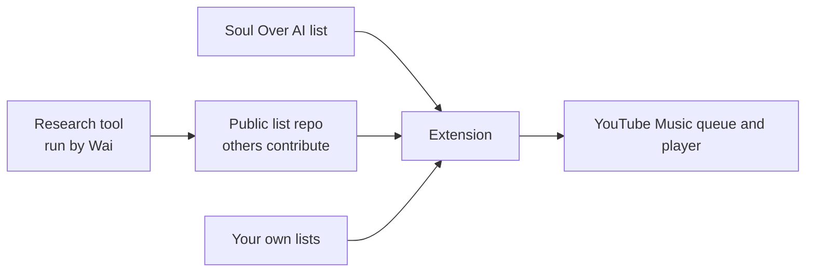
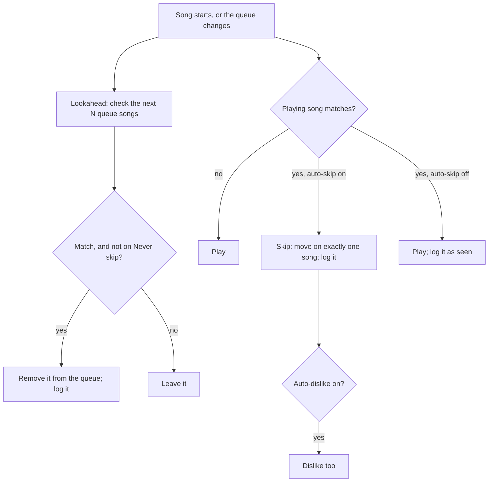

# Human Music: design

Status: Wai, 2026-11-11: "Just make some assumptions and go for now". Her
decisions are quoted; everything marked **(Claude's call)** is an
assumption she has not reviewed yet.

## Why

Wai, 2026-11-11: "I want to say that AI music is music and not immoral on its
own / I just want to use music as a way to connect to other humans, and AI is
categorically different (not inferior)".

Human Music is a Chrome extension for YouTube Music that keeps your listening
to music made by people. Songs by AI artists are taken out of the queue
before they play, or skipped if one plays anyway. It is not a campaign
against AI music, and nothing it says calls AI music bad.

It replaces Wai's use of an existing extension (YTM AI Artist & Song
Blocker) that has no license, so its code can't be reused or published.
Human Music is written from scratch and released under MIT.

## The two parts

| Part | What it is | Ships in the extension? |
|---|---|---|
| Extension | Filters YouTube Music against lists | yes (the `extension/` folder is the whole package) |
| Research tool | Wai runs it to find new AI artists | no, it lives in `research/` |

Wai: "the research blocker is a separate part that I run, keep it in the
repo but don't bundle it into the extension. when I run it myself, I will
make a repo or something that contains the list of discovered AI music that
others can contribute to."

So the research tool's findings reach users only through a public list,
which the extension subscribes to like any other filter list.

## Goals

1. Take songs by listed artists out of the queue before they play
   (lookahead), and skip any that play anyway, moving on exactly one song.
2. Filter lists you can switch on and off one by one: Soul Over AI first,
   later Wai's public list and others.
3. Your own lists of artists, songs and keywords, from the popup and from
   buttons on the player.
4. A clear log of every song taken out or skipped, with the list that
   caused it.
5. Import a backup exported from the old extension, so Wai keeps her lists.
6. Later: the research tool, and more community lists.

## Non-goals

- youtube.com. Human Music runs only on music.youtube.com.
- Judging audio, or judging artists inside the extension at all (that is
  the research tool's job).
- Searching lists in the popup. Wai: "users will just export their
  blocklists if they want to search them".
- On-screen notices while listening (Wai chose a quiet log).
- Firefox, for now.
- Publishing to the Chrome Web Store. Wai's call later; the code should be
  ready for it (license, credits, icons, no borrowed code).

## Anti-goals (failure even if it works)

- **Skipping or removing a real person's music.** It cuts off the human
  connection the tool exists for. Wai: a real indie artist being skipped is
  worse than an AI artist slipping through. Unsure means play.
- **Judgmental wording.** Never "slop", "fake", "garbage", "fight AI". Use
  "made by people" and "AI-generated". The log reads as information:
  "Removed from queue: AI-generated (Soul Over AI)".
- **Breaking playback.** Any failure (slow network, missing list, page
  change) means the song plays.
- **Copying the old extension.** No code, icons or text from it. Its
  observable behavior is described here; builders don't need its source.

## How the extension behaves

### What counts as a match

| List | Matches when |
|---|---|
| Filter list artists (Soul Over AI, others) | a credited artist is that name, or the artist's channel ID is listed |
| Your artists | a credited artist is that name |
| Your songs | the title is that title, by that artist (title only when the entry has no artist) |
| Your keywords | the word appears as a whole word in the title or the artist line |
| Never skip | overrides all of the above for that artist |

- **Credited artists** come from the artist line before the first " • "
  (the rest is album and year). A credited artist matches a listed name when
  the whole credit equals it, or one part of it does after splitting on
  ", ", " & " and " feat. ". Comparison ignores case. **(Claude's call:** the
  old extension matched artist names anywhere in title plus artist, so a
  list entry like "After Midnight" skipped every song with that title, a
  direct hit on the first anti-goal.)
- **Whole words** work for any script and for names with punctuation:
  "Beyoncé" must not match "Beyoncés"; "米津玄師", "Panic!" and "Ke$ha" must
  match. A word boundary is any character that is not a letter or digit in
  any language.
- Queue rows carry no channel IDs (checked live), so lookahead matches by
  name; channel IDs help only for the playing song, if its artist line
  links to the channel (to check live).
- A filter list switched to **watch mode** logs its matches but never
  removes or skips. **(Claude's call:** lets you try a new list safely.)

### Lookahead

Wai confirmed: check the next N songs in the queue against the lists and
take matches out of the queue before they play, so no skip is heard.

- N is the "lookahead distance" setting. Default 3, range 0 to 10; 0 turns
  lookahead off. **(Claude's call)**
- Runs when a song starts and when the queue changes.
- Removing uses the queue row's own menu ("Remove from queue"). Finding that
  menu item without depending on English text, and doing it without the
  queue panel jumping around, is the first thing to verify live.
- If removal fails, the song stays and auto-skip catches it when it plays.

### Skipping (auto-skip)

Auto-skip covers songs lookahead missed: the first song you start, songs
added at the last moment, lookahead set to 0. On by default; when off, a
match that is already playing plays and goes in the log as seen.
**(Claude's call)**

Moving on exactly one song is the hard part; these rules come from bugs
found in the old extension on 2026-11-11.

1. Remember the song (title and artist line) at the moment of the skip.
2. Press Next: the player's Next button when found, otherwise YouTube
   Music's own shortcut `j` (a keydown on the page body). The button is
   found by its English label, so `j` covers other page languages.
3. Watch for the song to change. Once it has changed, do nothing more.
4. If it has not changed after 1.5 s, jump to the end of the song, but only
   when the video has loaded (its duration is a finite number above 0).
   Never jump to an arbitrary large time.
5. Give up after 10 s. No timer keeps running after that.
6. With auto-dislike on: press Dislike first. YouTube Music usually moves
   on by itself after a dislike; only if the song hasn't changed after 2 s,
   run steps 2 to 5.
7. A song that was already checked is never checked again while it plays.
   The check compares title and artist line together.

### On the player

Two buttons next to the like and dislike buttons: "Block artist" (adds the
playing song's credited artists to your artists) and "Block song" (adds
title plus artist to your songs). Adding re-checks the playing song at
once. **(Claude's call:** kept from the old extension's feature set.)

## Popup

Three tabs (Wai's layout).

### 1. Lists

- **Filter lists**, one row each: name, artist count, last refresh, on/off
  toggle, watch-mode toggle, "Refresh now". Soul Over AI is built in.
  "Add list by URL" adds another (for Wai's future public list); Chrome asks
  the user to allow that host. **(Claude's call)**
- **Refresh frequency**, one setting for all lists: every 6 h, 12 h, daily
  (default), weekly, or manual. **(Claude's call)** A failed refresh keeps
  the last good copy.
- **Your lists**: Artists, Songs, Keywords, Never skip. Add and remove; no
  search.
- **Backup**: export everything (your lists, filter-list choices,
  settings) as one JSON file; import it back. Import also accepts the old
  extension's backup: an object with `blockedArtists`, `blockedKeywords`
  (arrays of strings) and `blockedTracks` (strings, or `{title, artist}`
  objects where an artist of "Manual Entry" means no artist).
- **Credit**: "Soul Over AI list by souloverai.com, CC BY 4.0."

### 2. Behaviour

| Setting | Default |
|---|---|
| Lookahead distance | 3 (0 to 10; 0 = off) |
| Auto-skip a playing match | on |
| Auto-dislike | off (Wai: "off by default") |
| Player buttons | on |
| Pause Human Music | off (one switch stops everything) |

The last three rows are **Claude's calls** (Wai asked "more?").

### 3. Log

Wai: "a clear log of every song that was skipped with details and source
list".

- One line per event, newest first: time, title, artist line, what happened
  (removed from queue, skipped, disliked, seen with auto-skip off, seen in
  watch mode), the list and the entry that matched.
- Each line has "Wrong: never skip this artist", which adds the artist to
  Never skip. **(Claude's call)**
- Keeps the last 1000 lines; "Clear log" and "Export log". **(Claude's
  call)**

## YouTube Music page facts (checked live 2026-11-11)

These describe YouTube's page, not anyone's code. YouTube changes its page
without notice, so selectors belong in one place in the code.

| Thing | New layout | Old layout |
|---|---|---|
| Player | `ytmusic-miniplayer` | `ytmusic-player-bar` |
| Title | `.ytmusicTrackInfoTitle` | `.title` inside the player |
| Artist line | `.ytmusicTrackInfoByline` | `.byline` inside the player |
| Next | `button[aria-label="Next"]` | `.next-button` |
| Dislike | `dislike-button-view-model` (its inner `button` has `aria-pressed`) | `.dislike` |
| Queue rows | `ytmusic-player-queue-item` with `.song-title`, `.byline`, a `selected` attribute; no links | same |

- Synthetic clicks on Next and a synthetic `j` keydown on `document.body`
  both work.
- Song rows in lists carry a `like-status` attribute (`LIKE`, `DISLIKE`,
  `INDIFFERENT`).
- The layout switch happened in 2026; keep both layouts working.

## Constraints

- Chrome Manifest V3, plain JavaScript, no build step, no dependencies.
  The `extension/` folder is loaded unpacked as is and is the whole
  package.
- Permissions: `storage`; hosts `https://music.youtube.com/*` and the Soul
  Over AI list URL; other list hosts as optional permissions, asked for
  when a list is added.
- Matching and skip logic live in plain modules with no page access, so
  Node tests can load them without a browser. Tests are `tests/*.test.mjs`,
  run with `node`, printing `N/N pass` and exiting 1 on any failure.
- Speed, with a 1375-name list: checking the same song again under 0.5 ms,
  a new song under 6 ms; a lookahead pass over 10 queue rows under 20 ms.
- MIT license; copyright "wai-lau".
- New icons (16, 48, 128 px), drawn for Human Music.
- Wording rules from the anti-goals apply to every string, including the
  manifest description and README.

## Phases

1. **Extension.** Everything above. Done when Wai uses Human Music instead
   of the old extension and the old extension's backup imports cleanly.
2. **Research tool**, in `research/`, never in `extension/`. Its design is
   `2026-11-11-ai-artist-checker-design.md` (approved 2026-11-11), changed
   by Wai's split: it no longer runs inside the extension or skips
   anything. It investigates artists and writes candidates for the public
   list, with evidence, for Wai to review. Its plan gets rewritten then.
3. **More community lists**: the ones ytm-deslop (MIT) merges (Stevoisiak,
   muhdiboy, AiSList, Cevval), matched by name or channel ID. First check
   each list's own license.

## Filter list format **(Claude's call)**

The extension reads two formats:

- Soul Over AI's: an array of records with `name` and `removed`;
  `removed: true` entries are ignored.
- Human Music's own, which the research tool and the public list use:
  `{"name": "...", "updated": "YYYY-MM-DD", "artists": [{"name": "...",
  "channelId": "UC... (optional)"}]}`.

## Left to the builder

- File and module layout inside `extension/`, within the constraints.
- Storage key names and the backup file's exact shape (it must round-trip).
- Popup look; plain and readable.
- Exact log line wording, within the wording rules.
- Icon design.

## Open

- Nothing blocking. Wai can overrule any **Claude's call** above.
