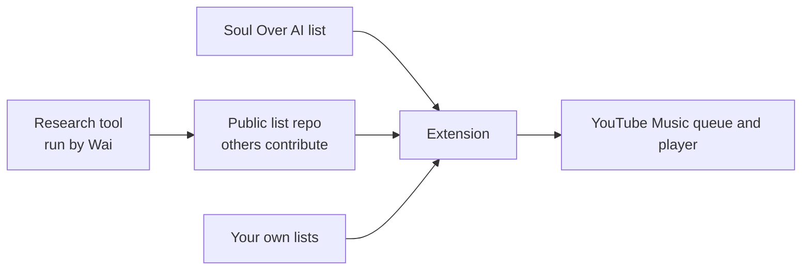
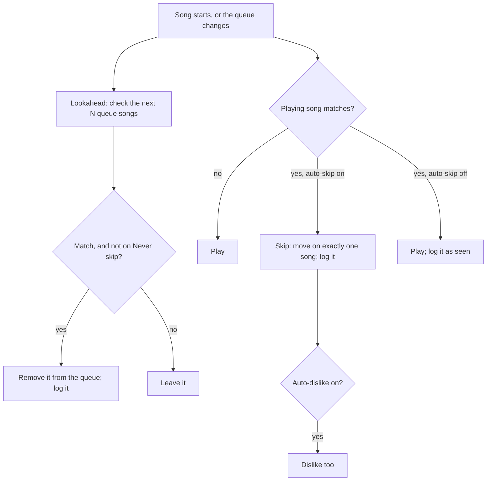

# Human Music: design

Status: Wai, 2026-11-11: "Just make some assumptions and go for now". Her
decisions are quoted; everything marked **(Claude's call)** is an
assumption she has not reviewed yet.

2026-11-17 note: where the text below differs from the code, the code wins. The
Pause switch became the four-stop filtering-mode slider (see the investigator
design); the display name is "Human Music: AI Music Blocker"; Spotify is
supported next to YouTube Music (see "Firefox and Spotify"); and these behaviours
changed after the 2026-11-17 review:

- Hidden page items are checked again on later passes and shown once they no longer
  match an acting list (YouTube Music reuses item elements).
- A search card for a person is read from its own title, subtitle and links, not the
  song rows inside it. A playlist card naming several artists counts as a mix; one by a
  single listed artist still hides.
- Queue removal does nothing while any menu is open, and stops before the next removal
  once filtering is off or the lists are gone.
- The skipper presses Next again or seeks only while the song is readable and is still
  the listed one.
- A song entry with a blank title never matches.
- "Always show" protects the listed artist that matched (else the first credited
  artist), also on duets.
- The log cuts a title, artist line, list name and entry to 300 characters each.
- Removing a list also deletes its downloaded data. A refresh time in the future counts
  as due.

## Why

Wai, 2026-11-11: "I want to say that AI music is music and not immoral on its
own / I just want to use music as a way to connect to other humans, and AI is
categorically different (not inferior)".

Human Music is a Chrome extension for YouTube Music that keeps your listening
to music made by people. Songs by AI artists are taken out of the queue
before they play, or skipped if one plays anyway. It is not a campaign
against AI music, and nothing it says calls AI music bad.

It replaces Wai's use of an existing extension (YTM AI Artist & Song
Blocker) that has no license, so its code can't be reused or published.
Human Music is written from scratch and released under MIT.

## The two parts

| Part | What it is | Ships in the extension? |
|---|---|---|
| Extension | Filters YouTube Music against lists | yes (the `extension/` folder is the whole package) |
| Research tool | Wai runs it to find new AI artists | no, it lives in `research/` |

Wai: "the research blocker is a separate part that I run, keep it in the
repo but don't bundle it into the extension. when I run it myself, I will
make a repo or something that contains the list of discovered AI music that
others can contribute to."

So the research tool's findings reach users only through a public list,
which the extension subscribes to like any other filter list.

## Goals

1. Take songs by listed artists out of the queue before they play
   (lookahead), and skip any that play anyway, moving on exactly one song.
2. Filter lists you can switch on and off one by one: Soul Over AI first,
   later Wai's public list and others.
3. Your own lists of artists, songs and keywords, from the popup and from
   buttons on the player.
4. Hide songs, albums, playlists and artists by listed artists on the home
   page, Explore and search results, like an ad blocker. Wai: "I want it to
   work like an adblock too, automatically hide the songs and playlists on
   the front page and from results".
5. A clear log of every song taken out or skipped, with the list that
   caused it.
6. Import a backup exported from the old extension, so Wai keeps her lists.
7. Later: the research tool, and more community lists.

## Non-goals

- youtube.com. Human Music runs only on music.youtube.com.
- Judging audio, or judging artists inside the extension at all (that is
  the research tool's job).
- Searching lists in the popup. Wai: "users will just export their
  blocklists if they want to search them".
- On-screen notices while listening (Wai chose a quiet log).
- Firefox, for now.
- Publishing to the Chrome Web Store. Wai's call later; the code should be
  ready for it (license, credits, icons, no borrowed code).

## Anti-goals (failure even if it works)

- **Skipping or removing a real person's music.** It cuts off the human
  connection the tool exists for. Wai: a real indie artist being skipped is
  worse than an AI artist slipping through. Unsure means play.
- **Judgmental wording.** Never "slop", "fake", "garbage", "fight AI". Use
  "made by people" and "AI-generated". The log reads as information:
  "Removed from queue: AI-generated (Soul Over AI)".
- **Breaking playback.** Any failure (slow network, missing list, page
  change) means the song plays.
- **Copying the old extension.** No code, icons or text from it. Its
  observable behavior is described here; builders don't need its source.

## How the extension behaves

### What counts as a match

| List | Matches when |
|---|---|
| Filter list artists (Soul Over AI, others) | a credited artist is that name, or the artist's channel ID is listed; an ID beats a name (2026-11-24 hardening) |
| Your artists | a credited artist is that name |
| Your songs | the title is that title, by that artist (title only when the entry has no artist, and then only on a song row: an album or playlist card with that title is left alone) (2026-11-24 hardening) |
| Your keywords | the word appears as a whole word in the title or a credited artist; never the album or year (Wai, 2026-11-13: "match correct fields in general, e.g. album to album, artist to artist") |
| Never skip | overrides all of the above for that artist |

- **Credited artists** come from the artist line before the first " • "
  (the rest is album and year). A credited artist matches a listed name when
  the whole credit equals it, or one part of it does. Comparison ignores case.
  (2026-11-24 hardening) Where the page links each artist, the linked names
  are the credits and nothing is split. In a plain text line, the line is split
  only at "feat.", "ft.", "featuring" and " x ", and into comma or "&" parts only
  when a part has two or more words ("Tyler, The Creator" gives "the creator",
  never "tyler"; "Earth, Wind & Fire" stays whole). **(Claude's call:** the
  old extension matched artist names anywhere in title plus artist, so a
  list entry like "After Midnight" skipped every song with that title, a
  direct hit on the first anti-goal.)
- (2026-11-24 hardening) **Generic names** ("The", "Various Artists",
  "Unknown", one character or no letters) never match by name on a filter
  list; your own lists are exempt, and an entry with an ID still matches by it.
  A verdict-list name that also belongs to a person (verdict human or unsure)
  matches by ID only. A name match gives way to IDs: when the song names
  artist IDs of the listed entry's kind and none is the entry's, it is a
  different artist with the same name.
- **Whole words** work for any script and for names with punctuation:
  "Beyoncé" must not match "Beyoncés"; "米津玄師", "Panic!" and "Ke$ha" must
  match. A word boundary is any character that is not a letter or digit in
  any language.
- Queue rows carry no channel IDs (checked live), so lookahead matches by
  name; channel IDs help only for the playing song, if its artist line
  links to the channel (to check live).
- A filter list switched to **watch mode** logs its matches but never
  removes or skips. **(Claude's call:** lets you try a new list safely.)

### Lookahead

Wai confirmed: check the next N songs in the queue against the lists and
take matches out of the queue before they play, so no skip is heard.

- N is the "lookahead distance" setting. Default 10, range 0 to 25; 0 turns
  lookahead off (Wai, 2026-11-23: default 10, cap "somewhere higher that is still reasonable").
- Runs when a song starts and when the queue changes.
- Removing uses the queue row's own menu ("Remove from queue"). Finding that
  menu item without depending on English text, and doing it without the
  queue panel jumping around, is the first thing to verify live.
- If removal fails, the song stays and auto-skip catches it when it plays.

### Skipping (auto-skip)

Auto-skip covers songs lookahead missed: the first song you start, songs
added at the last moment, lookahead set to 0. On by default; when off, a
match that is already playing plays and goes in the log as seen.
**(Claude's call)**

Moving on exactly one song is the hard part; these rules come from bugs
found in the old extension on 2026-11-11.

1. Remember the song (title and artist line) at the moment of the skip.
2. Press Next with YouTube Music's own shortcut `j` (a keydown on the page
   body). Wai, 2026-11-12: "Use shortcut keys when possible". Only if, 750 ms
   later, the same song is plainly still playing (the video running and its
   time moving on) click the player's Next button, so a slow but working key
   never leads to a second Next.
3. Watch for the song to change. Once it has changed, do nothing more.
4. If it has not changed after 1.5 s, jump to the end of the song, but only
   when the video has loaded (its duration is a finite number above 0).
   Never jump to an arbitrary large time.
5. Give up after 10 s. No timer keeps running after that.
6. With auto-dislike on: press Dislike first. YouTube Music usually moves
   on by itself after a dislike; only if the song hasn't changed after 2 s,
   run steps 2 to 5.
7. A song that was already checked is never checked again while it plays.
   The check compares title and artist line together.
8. (2026-11-24 hardening) The byline can lag the title for a moment after a
   song change, so a playing song is acted on only after the same title and
   artist line were read twice, 150 ms apart.
9. (2026-11-24 hardening) A second Next or a seek happens only if the video's
   length (and source, where the page gives one) is still what it was when the
   skip began; otherwise the player may already be on the next song, which may
   be a person's. After 6 skips within 20 s, auto-skip rests for 60 s and the
   log's Errors section gets one line. A site whose Next is switched off
   (Spotify Free's skip limit) is not pressed again or seeked: the skip is
   reported as one that didn't take.

### Never in the person's way

Wai, 2026-11-12: "the addon shouldnt be changing the user's focused tab".
Human Music acts only inside the YouTube Music page (keys and clicks sent to
its own elements); it never navigates, switches tabs or focuses a window, so
it works the same in a background tab. Opening a queue row's menu takes
keyboard focus (checked live), so lookahead waits while the person is typing
in a text field, and puts focus back where it was after each removal.

### On the player

One "Block artist" button just right of the repeat button, with a skip glyph
(a circle with a slash, as on an UNO skip card). Wai, 2026-11-12: "make these
buttons coherent wit the other buttons / keep the same colors, just have a
block artist button, space appropriately ... to the right of loop, a skip
glyph (like uno)". It is built from a copy of the repeat button's own wrapper,
so it has the controls' size, colours and spacing. Pressing it adds the
playing song's whole credit to your artists and the song is skipped at once.
Songs are blocked from the popup.

### Hiding on pages

Like an ad blocker, Human Music hides matching items so they never show.

- **Where:** the home page (`/`), Explore (`/explore`) and search results
  (`/search`). Album, playlist and artist pages are left alone: you went
  there on purpose. **(Claude's call)** The queue and the player are never
  touched by hiding (lookahead and auto-skip handle them).
- **What:** song rows, album/single/EP cards, playlist cards, artist cards and
  the top search result card.
- **Who an item is by:** the text and channel ID of its artist links
  (`a[href*="channel/"]`, checked live: search and home items have them).
  Without links, the subtitle's credits after a leading type word ("Song",
  "Album", "Single", "EP", "Playlist", "Artist", "Video").
- **Rule:** hide when a credited artist matches an `act` filter list or your
  artists, songs or keywords, and nobody credited is on Never skip.
  **Mix cards** (a subtitle that is only a comma list of featured artists,
  like "ILLENIUM, GameChops, El Jazzy Chavo") hide only when every named
  artist is listed: one AI artist in a mix doesn't hide the human ones.
  (2026-11-24 hardening) Any card or row that names several artists is a
  mix, linked or plain text, on both sites, and every artist in it must be
  listed. A text line whose whole is itself a listed act ("Earth, Wind &
  Fire") hides as that act. **(Claude's call)** Watch-mode lists never hide.
- **Undo:** pausing Human Music or switching hiding off shows everything
  again at once.
- **Log:** a hidden item gets one log line ("Hidden on page"), at most once
  a day per item, so a wrongly hidden person can be found and put on Never
  skip. **(Claude's call)**

### Marked rows (Wai, 2026-11-13)

Wai: "in search results and playlists, wherever you can still see the song,
make it look like this ... except instead of an exclamation mark just put
the skip symbol" (pointing at YouTube Music's own unavailable rows).

- **Where:** every song row still on the page (`ytmusic-responsive-list-item-renderer`
  on playlist, album, artist and search pages; not the queue, not the player
  page). Rows hidden by "Hiding on pages" stay hidden.
- **Look:** as YouTube Music draws an unavailable row (checked live): the
  row at opacity 0.6, the 48 px thumbnail (`.left-items
  ytmusic-thumbnail-renderer`) hidden, and a 24 px `#aaa` disc centred in its
  place, with the skip glyph cut out where YouTube Music puts "!".
- **Rule:** the row would be skipped: it matches like a hidden item (`act`
  lists, your lists, Never skip wins) and auto-skip is on and Human Music
  isn't paused. Every pass looks at every row again, since YouTube Music
  reuses a row element for another song.
- **Unclickable** (Wai: "make the songs that look blocked unclickable"):
  the row takes no pointer events and is `aria-disabled`, like YouTube
  Music's own unavailable rows. A wrongly listed artist is fixed from the
  Log ("Wrong: never skip this artist"); the row comes back at once.
- Rows without their artist on them (some album pages) stay as they are.

### The toolbar count (Wai, 2026-11-13)

Wai: "see how lastpass has this 1 symbol, show the same for human music,
where 1 is the number of songs skipped or blocked". The Human Music icon
shows, for each music tab, how many songs were skipped or removed from the
queue there since the tab was opened (grey badge, white text, nothing at 0).

## Popup

Three tabs (Wai's layout). Log comes first and the popup opens on it (Wai,
2026-11-13: "First Tab should be Log").

### 1. Lists

- **Filter lists**, one row each: name, artist count, last refresh, on/off
  toggle, watch-mode toggle, "Refresh now". Soul Over AI is built in.
  "Add list by URL" adds another (for Wai's future public list); Chrome asks
  the user to allow that host. **(Claude's call)** A new list starts in
  Watch only, so its matches show in the log before it acts; "Act at once"
  next to the button skips that step (Wai, 2026-11-13: Watch only first,
  with the option to act at once).
- **Refresh frequency**, one setting for all lists: every 6 h, 12 h, daily
  (default), weekly, or manual. **(Claude's call)** A failed refresh keeps
  the last good copy.
- **Your lists**: Artists, Songs, Keywords, Never skip. Add and remove; no
  search.
- **Backup**: export everything (your lists, filter-list choices,
  settings) as one JSON file; import it back. Import also accepts the old
  extension's backup: an object with `blockedArtists`, `blockedKeywords`
  (arrays of strings) and `blockedTracks` (strings, or `{title, artist}`
  objects where an artist of "Manual Entry" means no artist).
  (2026-11-24 hardening) Every import asks first and lists what it would add:
  new lists with their addresses, and the number of new artists, keywords and
  songs with the first few named. Development-only settings in a file are
  dropped, and a file over 2 MB is refused.
- (2026-11-24 hardening) **List limits.** A list holds at most 50,000
  entries; entries that are empty, one character, over 200 characters or very
  common words are skipped. An address that is an IP number, `localhost`, or
  ends in `.local` or `.internal` is refused. The refresh guard holds an update
  that adds an artist from the well-known list by name or ID, or more than 500
  new names at once, until the person looks at it.
- **Credit**: "Soul Over AI list by souloverai.com, CC BY 4.0."

### 2. Behaviour

| Setting | Default |
|---|---|
| Lookahead distance | 3 (0 to 10; 0 = off) |
| Auto-skip a playing match | on |
| Auto-dislike | off (Wai: "off by default") |
| Hide listed artists on pages | on |
| Player buttons | on |
| Pause Human Music | off (one switch stops everything) |

Player buttons and Pause are **Claude's calls** (Wai asked "more?"); hiding is Wai's.

### 3. Log

Wai: "a clear log of every song that was skipped with details and source
list".

- Three sections (Wai, 2026-11-15: "blocks: things that were 'adblocked' /
  actions: actions taken on behalf of the user, skip, dislike / errors"),
  switched at the top with a count each:
  - **Blocked**: kept from playing (removed from the queue, hidden on a page).
  - **Actions**: done while a song played (skipped, disliked; "Would skip"
    from Watch only lists; "Played" with auto-skip off).
  - **Errors**: a skip that didn't take (same song 10 s later), a queue row
    that couldn't be removed (once a day per song), a list update that
    failed. The song plays on in every case. A row whose removal failed is
    tried at most twice, 10 s apart, so its menu doesn't open on every check;
    auto-skip still catches it if it plays.
  The popup opens on the section of the newest entry.
- Grouped by artist (Wai: "grouping should be done by artist") so nothing
  repeats (Wai: "avoid repeating text in logs"). Each artist is one
  collapsed row (Wai, 2026-11-16: "collapse and sum each artist", "add
  chevron to expand artists"): a chevron, the name, the total, and an
  "Always show" switch ("a toggle, not a link") that puts the artist on
  Never skip and takes them off again; the switches' heading shows once.
  The reason sits under the name ("AI-generated · Soul Over AI", "Your
  artists", 'Keyword "x"'). Unfolded: each song once, newest first, with a
  short tag (Removed, Hidden, Skipped, Disliked, Would skip, Played,
  Couldn't skip, Couldn't remove), a count when it repeats, and a time ("5
  min ago", today's time, "Yesterday", "Nov 12"). The album and year aren't
  shown.
- Watch only is set per list under Behaviour (Wai, 2026-11-16: "watch only
  should go under behaviour, not lists"), not on the list cards.
- The header says what happened today ("3 skipped · 2 removed today", or
  "Paused") and holds the Pause switch.
- Keeps the last 1000 entries; "Clear log" and "Export log" (one full line
  per entry). **(Claude's call)** (2026-11-24 hardening) The store copy keeps
  at most 20,000 entries and about 3 MB; the oldest go first, so a long log
  can't fill the 10 MB the lists share.

## YouTube Music page facts (checked live 2026-11-11)

These describe YouTube's page, not anyone's code. YouTube changes its page
without notice, so selectors belong in one place in the code.

| Thing | New layout | Old layout |
|---|---|---|
| Player | `ytmusic-miniplayer` | `ytmusic-player-bar` |
| Title | `.ytmusicTrackInfoTitle` | `.title` inside the player |
| Artist line | `.ytmusicTrackInfoByline` | `.byline` inside the player |
| Next | `button[aria-label="Next"]` | `.next-button` |
| Dislike | `dislike-button-view-model` (its inner `button` has `aria-pressed`) | `.dislike` |
| Queue rows | `ytmusic-player-queue-item` with `.song-title`, `.byline`, a `selected` attribute; no links | same |
| Artist links (checked live 2026-11-17) | the names in `.ytmusicTrackInfoByline` are `a.ytAttributedStringLink` with `role="button"` and no `href`: no channel IDs in the player | not checked (`.byline` links read if they carry `channel/UC…`) |
| Cover (checked live 2026-11-17) | `#song-image img` on the watch page (544 px), else `img.ytmusicTrackInfoThumbnail` (60 px, same picture); both on `yt3.googleusercontent.com` | an `img` in the player on a Google image host |

- Synthetic clicks on Next and a synthetic `j` keydown on `document.body`
  both work.
- **Queue (checked live 2026-11-11, plan Task 0).** Rows live in
  `#queue ytmusic-player-queue-item` and exist while the player is minimized
  (no need to open the queue panel). Each song can have a hidden twin row (its
  video version) inside `div#counterpart-renderer`; skip those. The playing
  song's row sits in `div#primary-renderer` and has `selected`.
- **Removing a row.** Click the row's `ytmusic-menu-renderer button`; a
  visible `ytmusic-menu-popup-renderer` opens with `[role=menuitem]` items.
  "Remove from queue" is the item whose first `svg path` `d` is exactly
  `M9 .75a8.25 8.25 0 100 16.5A8.25 8.25 0 009 .75Zm0 1.5a6.75 6.75 0 110 13.5 6.75 6.75 0 010-13.5Zm3 6H6a.75.75 0 000 1.5h6a.75.75 0 100-1.5Z`
  (a circle with a minus; unique in that menu, so no English text needed).
  Clicking it closes the menu and removes the row within 1.5 s; nothing on
  screen moves. The same menu holds "Dismiss queue", which clears the whole
  queue, so only an exact icon match may be clicked. Escape (a keydown on
  `document`) closes the menu without acting.
- **Queue rows without menus (checked live 2026-11-12).** After a song is
  started from search, the up-next rows YouTube Music adds itself (its radio)
  carry no `ytmusic-menu-renderer` until the queue panel is drawn, and
  hovering does not create one. A right-click on the row (a `contextmenu`
  event) opens the same menu, "Remove from queue" included (Wai's pointer).
  `removeQueueRow` clicks the row's menu button when there is one and
  dispatches `contextmenu` otherwise; live, a radio row was removed 1.4 s
  after the queue filled.
- **Next in a Claude test tab (checked live 2026-11-12).** There, Next (a
  real click too, on any song) unloads the video and leaves the player
  stuck, so skipping can only be checked in Wai's own window.
- **Channel IDs.** The playing song's artist links have no `href`, and queue
  rows have no links, so the player and queue match by name only. Search and
  home items do link artists (`channel/UC…`), so hiding can match by channel ID.
- **Page items (checked live 2026-11-11).** Home and Explore: cards are
  `ytmusic-two-row-item-renderer` (`.title`, `.subtitle`); song rows (Quick
  picks) are `ytmusic-responsive-list-item-renderer`. Search: rows are
  `ytmusic-responsive-list-item-renderer` with subtitles like "EP • 1950
  SoulClub, 1960 SoulClub & Lewis Hanton • 2025"; the top result is
  `ytmusic-card-shelf-renderer`.
- Song rows in lists carry a `like-status` attribute (`LIKE`, `DISLIKE`,
  `INDIFFERENT`).
- The layout switch happened in 2026; keep both layouts working.

## Permissions (Wai, 2026-11-13: "minimize required permissions")

Only `storage`, `scripting` and the two music sites. No `alarms`: the worker
refreshes due lists each time it starts (a music tab opening or talking to
it, or the popup), which is often enough for a daily default. No host
permission for list downloads and no optional `https://*/*`: GitHub's raw
files allow any origin, and a list server that doesn't fails its refresh
with the error shown in the popup. `scripting` stays: without it, music tabs
already open when Human Music is installed or updated would do nothing until
reloaded.

## Constraints

- Chrome Manifest V3, plain JavaScript, no build step, no dependencies.
  The `extension/` folder is loaded unpacked as is and is the whole
  package.
- Permissions: `storage` and `scripting`; hosts `https://music.youtube.com/*`
  and `https://open.spotify.com/*` only (see "Permissions" above).
- Matching and skip logic live in plain modules with no page access, so
  Node tests can load them without a browser. Tests are `tests/*.test.mjs`,
  run with `node`, printing `N/N pass` and exiting 1 on any failure.
- Speed, with a 1375-name list: checking the same song again under 0.5 ms,
  a new song under 6 ms; a lookahead pass over 10 queue rows under 20 ms;
  a hiding pass over 100 page items under 30 ms.
- MIT license; copyright "wai-lau".
- New icons (16, 48, 128 px), drawn for Human Music.
- Wording rules from the anti-goals apply to every string, including the
  manifest description and README.

## Lists that survive removal (Wai, 2026-11-12)

Removing the old extension deleted its lists (Chrome wipes an extension's
storage on removal). Wai: "save the lists in chrome storage, save a local
copy that is auto-imported and committed (for now) / In the future, the
extension should be bundled without the lists, it should auto-download and
import from \"known lists\" that it is shipped with".

- **Now.** Lists live in `chrome.storage.local`. `extension/lists/` holds a
  committed copy: `index.json` names the files; `my-lists.json` is a Human
  Music backup of your own lists; `soul-over-ai.json` is a names-only
  snapshot of the Soul Over AI list (CC BY 4.0). On install and on every
  start the service worker imports each file whose content changed since the
  last import: a backup merges into your lists (a union, so an entry deleted
  in the popup stays deleted until the file changes); a filter-list file
  fills that list only while it has no downloaded copy.
  `scripts/save-lists.sh` copies the newest popup Export from Downloads into
  `my-lists.json` and commits it.
- **Later.** The package ships with no list data, only a file of known list
  URLs, and downloads and imports those on install.

## Firefox and Spotify (foundation, 2026-11-13)

Wai, 2026-11-13: "Also want you to figure out how to make it work for Firefox
and Spotify / do anything that lays the foundation that will not require my
input".

### Sites

One content script runs on each supported site and picks that site's page
adapter by host: `HM.ytm` (music.youtube.com) or `HM.spotify`
(open.spotify.com). Both adapters have the same shape (readSong, readQueue,
clickNext, pressNextKey, clickDislike, videoDuration, videoState, seekTo,
removeQueueRow, mountPlayerButtons, readPageItems, hideItem, unhideAll), so
matching, lookahead, skipping, hiding and the log are shared.

### Artist IDs

Every Soul Over AI record carries a Spotify artist ID (1375 of 1375) and most
a YouTube channel ID (1279). Lists keep both (`spotifyId`, `channelId`), and a
song or page item whose artist links carry a listed ID matches that artist
whatever name it shows. On Spotify every artist link carries its ID, so
Spotify matching is by ID first.

### Spotify page facts (checked live 2026-11-13, logged in)

| Thing | Where |
|---|---|
| Now playing | `[data-testid="now-playing-widget-v2"]` (no `now-playing-widget` in the narrow layout) |
| Title | `[data-testid="context-item-link"]` |
| Artists | `[data-testid="now-playing-widget-v2-byline"] a[href*="/artist/"]`, each href holds the 22-character artist ID |
| Next | `[data-testid="control-button-skip-forward"]`; a script click works (unlike YouTube Music in a test tab) |
| Repeat | `[data-testid="control-button-repeat"]` (32 px tertiary button; the block button goes right of it) |
| Play/pause | `[data-testid="control-button-playpause"]` (aria-label Play or Pause) |
| Position, duration | `[data-testid="playback-position"]`, `[data-testid="playback-duration"]` (text like 2:43), `[data-testid="playback-progressbar"]` |
| Queue panel | `[data-testid="control-button-queue"]` opens `aside[aria-label="Queue"]`; rows are `ul[role="treegrid"] li[role="row"]` with track and artist links and a "More options" button |
| Remove from queue | "More options" opens `#context-menu` (`data-testid="context-menu"`); the item whose icon path is the trash can below; "Exclude from your taste profile" and "Go to album" share another icon's start, so only an exact match counts |
| Search results | `[data-encore-id="listRow"]` rows in `[role="grid"][aria-label="Search results"]` (narrow layout), with track and artist links |
| Home cards | `[data-encore-id="card"]` with `cardTitle` and `cardSubtitle`; most are playlists whose subtitle is a description, not credits |

- The page's `<video>` element reports a duration that is not the song's
  (7.36 s for a 2:43 song), so seeking uses the progress bar, not the video.
- Shortcut keys sent by script (Ctrl+Right, Alt+Shift+Right, Shift+Right) did
  not move on; Spotify skips with the Next button.
- Spotify has no dislike; with auto-dislike on, Spotify only presses Next (Wai: "nothing").
- Hiding on Spotify goes by artist links only (their IDs, or the linked
  name): a playlist subtitle is a description and is never read as credits.
- Remove-from-queue icon: `M5.25 3v-.917C5.25.933 6.183 0 7.333 0h1.334c1.15 0 2.083.933 2.083 2.083V3h4.75v1.5h-.972l-1.257 9.544A2.25 2.25 0 0 1 11.041 16H4.96a2.25 2.25 0 0 1-2.23-1.956L1.472 4.5H.5V3zm1.5-.917V3h2.5v-.917a.583.583 0 0 0-.583-.583H7.333a.583.583 0 0 0-.583.583M2.986 4.5l1.23 9.348a.75.75 0 0 0 .744.652h6.08a.75.75 0 0 0 .744-.652L13.015 4.5H2.985z`

### Spotify's Queue panel (Wai, 2026-11-13)

Spotify draws its queue only in the Queue panel. Asked whether lookahead
should open it, Wai: "yes". Human Music opens the panel itself once while a
song is loaded; if the person closes it, it stays closed until Spotify is
reloaded (Human Music never fights them over it). Asked what auto-dislike
should do on Spotify, which has no dislike, Wai: "nothing": it only skips and
never changes the account.

Then, Wai: "Try reopening the queue panel again when the song is about to end
and the next queue is not open and if when the lookahead has not happened
yet". With 15 s or less left in a song, the panel closed and the upcoming
songs not yet seen during that song, Human Music opens the panel once for
that song and removes a listed next song. (2026-11-24 hardening) Human
Music never opens the Queue panel over another right-hand panel (Lyrics, Now
Playing view, Devices, Friend activity), and a panel the person closed stays
closed: the last-chance check no longer reopens it. 15 s leaves time
for the panel to open (up to about 4 s live) and a removal (about 0.5 s).

### Spotify, checked live (2026-11-13)

- Search for The Velvet Sundown: 33 items hidden, each crediting a listed
  artist (two are duets with unlisted names; any listed credit hides an
  item, as on YouTube Music).
- Lookahead with the Queue panel open: "Dust on the Wind" added with "Add to
  queue" was removed 0.4 s after it appeared, without playing.
- The Block artist button sits right of Repeat.
- Last chance, with the panel closed by hand: a song by people was seeked to
  2:30 of 2:52 through the progress bar (the adapter's seek works); at 2:37
  the panel opened, the queue was checked, and it closed again at 2:38.
- Not checked live: skipping a listed song that starts playing (playing one
  would put AI music into Wai's Spotify history); covered by tests.

### Firefox

Firefox runs Manifest V3 with `background.scripts` (no service worker), needs
`browser_specific_settings.gecko.id`, and offers `chrome.*` APIs. Until a
combined manifest is checked live in Chrome, `scripts/build-firefox.sh` writes
a Firefox copy of `extension/` to `dist/firefox/` with a Firefox manifest;
the Chrome package stays as it is. The service worker's `importScripts` is
skipped there (the core files are listed in `background.scripts`).

## Phases

1. **Extension.** Everything above. Done when Wai uses Human Music instead
   of the old extension and the old extension's backup imports cleanly.
2. **Research tool**, in `research/`, never in `extension/`. Its design is
   `2026-11-11-ai-artist-checker-design.md` (approved 2026-11-11), changed
   by Wai's split: it no longer runs inside the extension or skips
   anything. It investigates artists and writes candidates for the public
   list, with evidence, for Wai to review. Its plan gets rewritten then.
3. **More community lists**: the ones ytm-deslop (MIT) merges (Stevoisiak,
   muhdiboy, AiSList, Cevval), matched by name or channel ID. First check
   each list's own license.

## Filter list format **(Claude's call)**

The extension reads two formats:

- Soul Over AI's: an array of records with `name` and `removed`;
  `removed: true` entries are ignored.
- Human Music's own, which the research tool and the public list use:
  `{"name": "...", "updated": "YYYY-MM-DD", "artists": [{"name": "...",
  "channelId": "UC... (optional)"}]}`.

## Left to the builder

- File and module layout inside `extension/`, within the constraints.
- Storage key names and the backup file's exact shape (it must round-trip).
- Popup look; plain and readable.
- Exact log line wording, within the wording rules.
- Icon design.

## Open

- Nothing blocking. Wai can overrule any **Claude's call** above.
