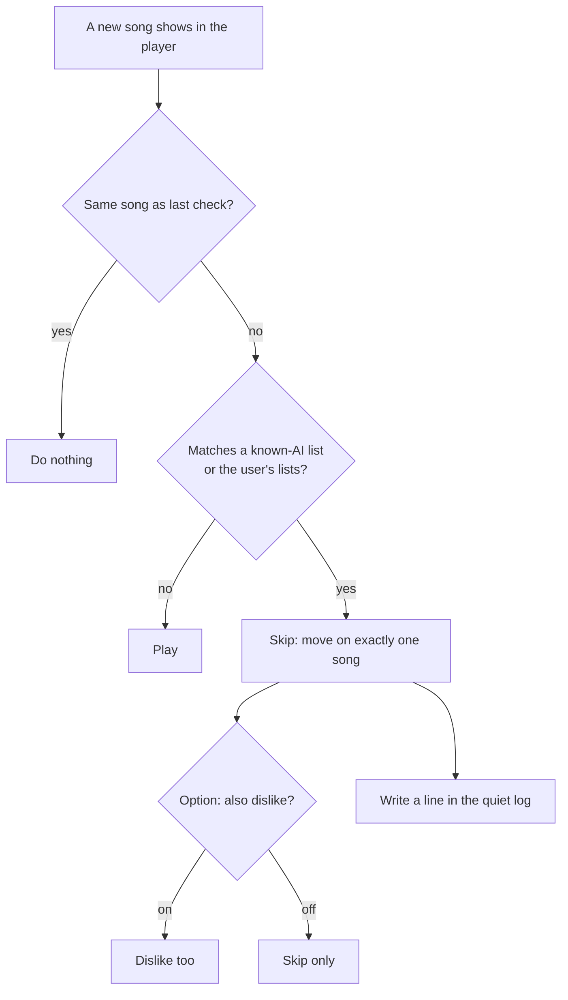

# HumanMusic: design

Status: draft for Wai's approval, 2026-11-11.

## Why

Wai, 2026-11-11: "I want to say that AI music is music and not immoral on its
own / I just want to use music as a way to connect to other humans, and AI is
categorically different (not inferior)".

HumanMusic is a Chrome extension for YouTube Music that keeps your listening
to music made by people. When a song by an AI artist comes up, it moves on to
the next song. It is not a campaign against AI music, and nothing it says
calls AI music bad.

It replaces Wai's use of an existing extension (YTM AI Artist & Song
Blocker) that has no license, so its code can't be reused or published.
HumanMusic is written from scratch and released under MIT.

## Goals

1. Skip songs whose artist is on a known-AI list or on the user's own lists,
   moving on exactly one song each time.
2. Let the user keep their own lists of artists, songs and keywords, from
   the popup and from buttons on the player.
3. Use the Soul Over AI list (1375 artists on 2026-11-11), credited as its
   CC BY 4.0 license requires.
4. Later phases: judge new artists before they play (the AI checker,
   `2026-11-11-ai-artist-checker-design.md`), and more known-AI lists
   matched by channel ID.
5. Import a backup exported from the old extension, so Wai keeps her lists.

## Non-goals

- youtube.com. HumanMusic runs only on music.youtube.com.
- Judging audio. HumanMusic reads public information about artists.
- A shared or public database of verdicts.
- On-screen notices while listening (Wai chose a quiet log).
- Firefox, for now.
- Publishing to the Chrome Web Store. That is Wai's call later; the code
  should be ready for it (license, credits, icons, no borrowed code).

## Anti-goals (failure even if it works)

- **Skipping a real person's music.** It cuts off the human connection the
  tool exists for. Wai: a real indie artist being skipped is worse than an
  AI artist slipping through. Unsure means play.
- **Judgmental wording.** Never "slop", "fake", "garbage", "fight AI". Use
  "made by people" and "AI-generated". The log reads as information:
  "Skipped: AI-generated (Soul Over AI list)".
- **Breaking playback.** Any failure (slow network, missing list, page
  change) means the song plays.
- **Copying the old extension.** No code, icons or text from it. Its
  observable behavior is described here; builders don't need its source.

## How it behaves

### What counts as a match

| List | Matches when |
|---|---|
| Known-AI artists (Soul Over AI) | a credited artist is that name |
| User's artists | a credited artist is that name |
| User's songs | the title is that title, by that artist (title only when the entry has no artist) |
| User's keywords | the word appears as a whole word in the title or the artist line |

- **Credited artists** come from the artist line before the first " • "
  (the rest is album and year). A credited artist matches a listed name when
  the whole credit equals it, or one part of it does after splitting on
  ", ", " & " and " feat. ". Comparison ignores case. (Claude's call: the old
  extension matched artist names anywhere in title plus artist, so a list
  entry like "After Midnight" skipped every song with that title, a direct
  hit on the first anti-goal. Exact credit matching avoids that.)
- **Whole words** work for any script and for names with punctuation:
  "Beyoncé" must not match "Beyoncés"; "米津玄師", "Panic!" and "Ke$ha" must
  match. A word boundary is any character that is not a letter or digit in
  any language.
- Soul Over AI entries marked `removed: true` are ignored. The list is an
  array of records with a `name` field, fetched from
  `https://raw.githubusercontent.com/xoundbyte/soul-over-ai/main/dist/artists.json`.

### Skipping

Moving on exactly one song is the hard part; these rules come from bugs
found in the old extension on 2026-11-11.

1. Remember the song (title and artist line) at the moment of the skip.
2. Press Next: the player's Next button when found, otherwise YouTube
   Music's own shortcut `j` (a keydown on the page body). The button is
   found by its English label, so `j` covers other page languages.
3. Watch for the song to change. Once it has changed, do nothing more.
4. If it has not changed after 1.5 s, jump to the end of the song, but only
   when the video has loaded (its duration is a finite number above 0).
   Never jump to an arbitrary large time.
5. Give up after 10 s. No timer keeps running after that.
6. With the dislike option on: press Dislike first. YouTube Music usually
   moves on by itself after a dislike; only if the song hasn't changed
   after 2 s, run steps 2 to 5.
7. A song that was already checked is never checked again while it plays.
   The check compares title and artist line together.

### On the player

Two buttons next to the like and dislike buttons: "Block artist" (adds the
playing song's credited artists to the user's artists) and "Block song"
(adds title plus artist to the user's songs). Adding to a list re-checks
the playing song at once, so it is skipped.

### Popup

- Tabs: Artists, Songs, Keywords (the user's lists: add, remove, search),
  Known AI (the Soul Over AI count, last refresh time, a refresh button),
  and later Log (the quiet log of skips and, in phase 2, checker verdicts).
- Export and import as a JSON file. Import also accepts the old extension's
  backup: an object with `blockedArtists`, `blockedKeywords` (arrays of
  strings) and `blockedTracks` (strings, or `{title, artist}` objects where
  an artist of "Manual Entry" means no artist).
- Option: "Also dislike skipped songs", off by default.
- Credit line: "Known-AI artists from Soul Over AI (souloverai.com),
  CC BY 4.0."

## YouTube Music page facts (checked live 2026-11-11)

These describe YouTube's page, not anyone's code. YouTube changes its page
without notice, so selectors belong in one place in the code.

| Thing | New layout | Old layout |
|---|---|---|
| Player | `ytmusic-miniplayer` | `ytmusic-player-bar` |
| Title | `.ytmusicTrackInfoTitle` | `.title` inside the player |
| Artist line | `.ytmusicTrackInfoByline` | `.byline` inside the player |
| Next | `button[aria-label="Next"]` | `.next-button` |
| Dislike | `dislike-button-view-model` (its inner `button` has `aria-pressed`) | `.dislike` |
| Queue rows | `ytmusic-player-queue-item` with `.song-title`, `.byline`, a `selected` attribute; no links, so no channel IDs | same |

- Synthetic clicks on Next and a synthetic `j` keydown on `document.body`
  both work.
- Song rows in lists carry a `like-status` attribute (`LIKE`, `DISLIKE`,
  `INDIFFERENT`).
- The whole layout switch happened in 2026; keep both layouts working.

## Constraints

- Chrome Manifest V3, plain JavaScript, no build step, no dependencies.
- Permissions: `storage`; hosts `https://music.youtube.com/*` and the Soul
  Over AI list URL. Phase 2 adds what the checker design names.
- Matching and skip logic live in plain modules with no page access, so
  Node tests can load them without a browser. Tests are `tests/*.test.mjs`,
  run with `node`, printing `N/N pass` and exiting 1 on any failure.
- Speed, with a 1375-name list: checking the same song again under 0.5 ms,
  a new song under 6 ms.
- MIT license; copyright "wai-lau".
- New icons (16, 48, 128 px), drawn for HumanMusic.
- Wording rules from the anti-goals apply to every string, including the
  manifest description and README.

## Phases

1. **Core.** Everything above, without the Log tab's checker verdicts. Done
   when Wai uses HumanMusic instead of the old extension and the old
   extension's backup imports cleanly.
2. **AI checker.** `2026-11-11-ai-artist-checker-design.md`, approved
   2026-11-11, carried over from the old repo. Where it names the old code
   (`content.js`, `blockCurrentSong`, `checkAndSkip`), read: HumanMusic's
   content script and its skip path. Its plan gets rewritten for this repo.
3. **More known-AI lists.** The community lists that the MIT-licensed
   ytm-deslop project merges (Stevoisiak, muhdiboy, AiSList, Cevval), matched
   by channel ID. First check each list's own license, and check live
   whether the playing song's artist line carries channel links.

## Left to the builder

- File and module layout, within the constraints.
- Storage key names and the export file's exact shape (it must round-trip).
- How often the Soul Over AI list refreshes (at least once a day, and on
  the refresh button); keep the last good copy when a fetch fails.
- Popup look; plain and readable.
- Exact log line wording, within the wording rules.
- Icon design.

## Open

- Nothing yet.
