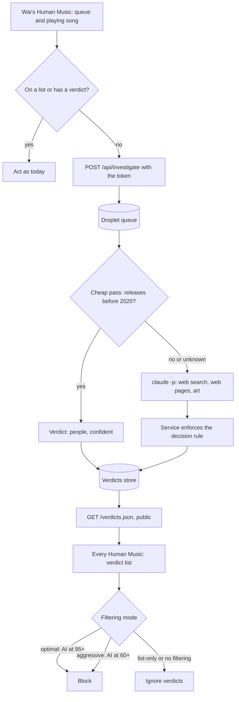
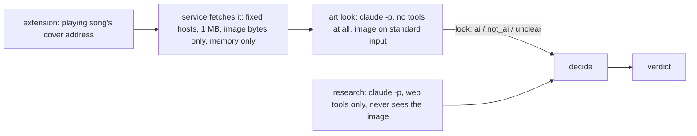

# AI investigator: design

Status: approved by Wai 2026-11-16 ("Looks good / Go"); covers and the separate verdicts repo approved 2026-11-17; corrected the same day: the verdict list is published on GitHub, not served by the droplet (below).

## Why

The lists Human Music blocks from stop growing (Soul Over AI's newest entry is
from February), while new AI-generated artists keep appearing. Wai spots them
herself by their art and by having no history from before generative music
tools. The investigator does that spotting for her, a step ahead of playback,
and remembers every answer so no artist is investigated twice. Its findings
become a public list that every Human Music can use.

This brings back the checker designed on 2026-11-11
(`~/src/YTM-AI-Artist-Song-Blocker/docs/superpowers/specs/2026-11-11-ai-artist-checker-design.md`),
which was then moved out of the extension into a research tool. Wai's newer
target overrides that split for the sending part; the judging still happens
outside the extension.

## What Wai decided (2026-11-15/16)

- The feature: "it should look ahead in the queue, and checks if
  songs/artists post-2019 are AI when not on any list"; "save all findings
  with confidence level / this way, we don't need to search something
  multiple times".
- A uBlock Origin style setting with four stops: "no filtering / list-only /
  optimal, searches and blocks 95% confidence AI music / aggressive, blocks
  60%+ confidence".
- Who judges: "claude subscription". "we give it a URL to send all of a
  song/artist/album's metadata and album art / my claude subscription will
  investigate the AI level save it to its own storage and list with a
  confidence level".
- Who sends: "only my copy". Every other copy only reads the published list.
- Where: "on the droplet" (wai-lau.net), which also serves the list.

## Correction (Wai, 2026-11-16)

Wai: "my developer copy is the only one that calls the investigator / The
investigator should update something in a public repo (this one) / The
extension will download from GH once in a while to keep the lists in sync".

- The droplet runs the investigator only; it no longer serves
  `verdicts.json`. Only Wai's copy ever contacts it.
- After each verdict, the investigator commits the updated
  `verdicts.json` to a public GitHub repo (which one is an open question:
  this repo is private today).
- Every Human Music downloads the list from GitHub on its normal refresh
  schedule, like Soul Over AI; GitHub raw files allow any origin, so no
  permission changes, and no ordinary user ever reaches Wai's server (no
  visitor IP addresses in her logs; the store's "collects no data" answer
  stays true).
- The droplet needs a write credential for that one repo (a deploy key),
  set up with Wai's yes like the other setup steps.
- **Which repo (Wai, 2026-11-17): a separate one, `wai-lau/human-music-verdicts`.**
  A deploy key on this repo could write the extension's code, and the
  investigator feeds strangers' text to Claude; a key for a repo that holds
  only `verdicts.json` can't reach the code at all. The extension reads
  `https://raw.githubusercontent.com/wai-lau/human-music-verdicts/main/verdicts.json`.

Where the text below still says the droplet serves the list, this
correction wins.

## The key (Wai, 2026-11-16)

Wai: "ensure that the endpoint for running the investigator is gated by my
wai-lau.net admin keys", then chose a key derived from the admin key. The
investigator answers at its public address (Wai's choice) but accepts only
`Authorization: Bearer <key>` where key is
`sha256("human-music-investigator:" + API_KEY)` in hex, API_KEY being
exec-fn's admin key (exec-fn derives its login cookie the same way).

**The investigator never holds the admin key** (Wai, 2026-11-16, "yes do
safer", after a side agent pointed out that the service feeds text anyone
can write to Claude, so a prompt injection could try to read what the
service holds). A one-time step on the droplet, run by Wai (it reads exec-fn's
API_KEY), prints the derived key once for her to paste into her developer
copy, and writes only `sha256(derived key)` in hex to the investigator's
environment file as `HM_KEY_HASH`. The service hashes each presented key
and compares it to `HM_KEY_HASH` with `crypto.timingSafeEqual`. So the
service holds neither the admin key nor the derived key: reading its files
or environment opens nothing. A leaked derived key opens only the
investigator; changing the admin key means running the step again. Wherever
this document says "token", it means the derived key.

## Goals

1. Wai's copy sends every upcoming song whose artist no list and no verdict
   covers (title, artist, album, art link, artist IDs) to the investigator.
2. The investigator, on Wai's Claude subscription, decides per artist: AI,
   people, or unsure, with a confidence (0-100) and short reasons with sources.
   Artists with releases from before 2020 are settled as people cheaply,
   without a deep investigation ("post-2019").
3. Every verdict is stored on the droplet and never investigated again unless
   Wai asks.
4. The droplet publishes all verdicts as a list; every Human Music reads it.
5. The filtering mode decides what blocks: list-only ignores verdicts,
   optimal blocks AI verdicts at 95+, aggressive at 60+.
6. Blocking means what it means today: removed from the queue, skipped,
   hidden, greyed out, logged (with the confidence in the log reason).

## Non-goals

- Store users sending anything. Their copies never contact the investigator.
- Judging audio. The investigator reads public information and art; it may
  read Deezer's audio-based AI label where the web shows it.
- On-screen notices. The log stays the place to look.
- Contributions from other people to the verdict list (later, maybe).

## Anti-goals (failure even if it works)

- **Skipping a real person at "optimal".** 95 must mean that at most about 1
  in 20 such verdicts is wrong, checked against known artists before it ships
  (see Calibration). Aggressive (60) accepts more mistakes; people choose it.
- **Playback waiting on the investigator.** Sending is fire-and-forget; a
  slow, offline or broken investigator changes nothing about playback.
- **Burning the subscription.** One investigation per artist, ever; a daily
  cap; nothing from anyone but Wai's copy.
- **A page or a name steering the verdict.** Pages and metadata are data; the
  service enforces the decision rule, not just the prompt.

## How it works



### In the extension (every copy)

- **Filtering mode** replaces the Pause switch in the popup header: a
  four-stop slider like uBlock Origin's, labelled with the current stop.
  - No filtering: Human Music does nothing (today's Pause).
  - List-only: today's behaviour.
  - Optimal: list-only plus AI verdicts at 95 or more.
  - Aggressive: list-only plus AI verdicts at 60 or more.
  The setting `paused: true` migrates to No filtering.
- **The verdict list** is a second built-in filter list, "Human Music
  verdicts", fetched from the droplet like any list (refresh setting applies;
  the droplet sends `Access-Control-Allow-Origin: *`, so no new permission).
  Only entries with verdict `ai` matter; the mode's threshold picks which.
  People and unsure verdicts never override anything, and Never skip still
  wins over everything.
- **Matching** uses the artist IDs when the entry has them (Spotify artist
  ID, YouTube channel ID) and the name otherwise, like the lists today.
- **Log:** a verdict block shows its reason as "AI-generated · Human Music
  verdicts · 97%".

### In Wai's copy only (when an investigator token is set)

- **Sending.** Lookahead and the playing-song check collect artists that
  match no list entry and no verdict (any verdict, any confidence) and send
  them in small batches to `POST https://wai-lau.net/human-music/api/investigate`
  with `Authorization: Bearer <token>`. Each item: site, title, artist line
  and credited names, album, art URL, artist IDs when the page shows them.
  Each artist is sent at most once per day from a copy (kept in storage).
- **Fresh verdicts.** While it has artists waiting, Wai's copy re-reads the
  verdict list every few minutes instead of waiting for the daily refresh, so
  a verdict can act on the next song by that artist.
- **The token** is set in the popup (Behaviour, under "Investigator") and
  kept in its own storage key that only the worker and the popup read; the
  content script sees only an on/off setting (`investigate`). (Correction,
  Claude's call while planning: `setAccessLevel` limits the whole local
  storage area, which the content scripts must keep reading, so it can't
  shield one key. Pages can't read extension storage either way.) The worker
  does the sending, not the content script.

### On the droplet

- **A small HTTPS service** at `https://wai-lau.net/human-music/`:
  - `POST /api/investigate` (token): accepts a batch, answers at once
    (202), queues new artists, ignores known ones.
  - `GET /verdicts.json` (public, CORS open, cacheable): every verdict.
  - `GET /api/status` (token): queue length, today's count, last error.
- **A worker** takes one artist at a time:
  1. **Cheap pass:** look up the artist's release history (MusicBrainz and
     the like, or a short web search). Clear releases before 2020: verdict
     people, high confidence, no deep investigation.
  2. **Investigation:** `claude -p` on Wai's subscription, with only web
     search and web fetch, and Read inside a scratch folder holding the art
     (downloaded by the service from image hosts it trusts, size-capped). It
     returns JSON: verdict, confidence, signal ids, reasons, sources.
  3. **Decision rule, enforced by the service:** `ai` only with two
     different signals, or one strong one (a Deezer AI label, the artist's
     own disclosure, a tracker listing). The art never decides alone.
     Otherwise the verdict is `unsure`. Signals, in rough order of strength:
     Deezer AI label; no human footprint (no label, tours, interviews, real
     socials, credits naming people); a short, heavy catalogue starting 2024
     or later; AI-style art; tracker flags (SoullessMusic, SlopTracker,
     Spotify's AI badge, own disclosure).
- **Storage:** one SQLite file. A verdict per artist (keys: Spotify ID,
  YouTube channel ID, normalised name; merged when one artist shows up on
  both sites), with confidence, reasons, sources, model and date.
- **Limits:** one investigation at a time; a daily cap (start at 100,
  adjustable); requests over size or without the token are refused.
- **Runs as its own unprivileged user**, as a systemd service, with its own
  Claude Code login (Wai logs in once). Its root-readable environment file
  holds only the token's hash (see The key).

### Verdict list format

Human Music's list format plus the verdict fields:

```json
{
  "name": "Human Music verdicts",
  "updated": "2026-11-16T12:00:00Z",
  "artists": [
    { "name": "The Velvet Sundown", "spotifyId": "2GRtyAXWUiisGYub5SGMrb",
      "channelId": "UCLeR-eGh2OFy9ydX7IUcOTw", "verdict": "ai",
      "confidence": 98, "checked": "2026-11-16" }
  ]
}
```

Reasons and sources stay on the droplet (shown at
`/verdicts/<key>` for anyone who wants to check a verdict); the list carries
only what extensions need, to keep it small.

### A second opinion: SH Labs (Wai, 2026-11-16)

Wai, pointing at https://shlabs.music: "we might be able to use this / we
can compare against our investigator". SH Labs (SubmitHub's technology
division) judges the audio of one track: `POST /api/v1/detect` with an
`X-API-Key`, given a Spotify track ID, an ISRC or a direct audio address; it
answers a 0-100 AI probability, a label (Human Made, Pure AI Generated,
Processed AI Generated) and the likely generator. Its free plan allows 500
tracks a day, 10 a minute, but for Spotify IDs it hears only the 30-second
preview (its docs warn those scores can differ from full-track ones); full
tracks cost $50 a month.

How the investigator uses it (Claude's reading, for Wai to check):

- **For comparison, not for verdicts.** For each investigated artist with a
  Spotify ID (Spotify items carry one; for YouTube Music artists, when
  Claude's research finds them on Spotify), the service asks SH Labs about
  up to two tracks and stores the scores beside the verdict on the droplet.
  The calibration report then shows where the two agree and where they
  don't; the disagreements are what Wai reviews.
- **Never published.** SH Labs scores stay on the droplet and out of the
  public list: its terms forbid redistributing the service and using a
  result as the only basis for a decision against a person. Putting its
  scores in the list would need SH Labs's written yes.
- **Its key stays out of Claude's reach.** The service code calls SH Labs
  itself; the key sits in the service's environment file, and Claude never
  sees it (the same reasoning as The key).
- Start on the free plan; move to full tracks only if the previews turn out
  too noisy to compare.

### Album art, safely (Wai, 2026-11-16)

Wai: "yes, design it safely, think hard", after a side agent noted that the
service plan had dropped the covers she asked for. A cover that looks
AI-made is a clue, never proof. The danger is how Claude sees it: the
droplet holds keys, and any text inside a cover is written by strangers.

Two rules settle it. **No Claude process ever gets a file tool**, so the
cover never touches the disk where Claude could reach it. And **the call
that looks at the cover is not the call that searches the web**, so text
hidden in an image can't steer a web fetch.



1. **The address.** The extension sends the playing song's cover address
   (`artUrl`), read from the player on both sites.
2. **The fetch (service code, never Claude).** https only; the host must be
   one of `lh3.googleusercontent.com`, `yt3.googleusercontent.com`, `yt3.ggpht.com`, `i.ytimg.com`
   (YouTube Music), `i.scdn.co`, `mosaic.scdn.co`,
   `image-cdn-ak.spotifycdn.com`, `image-cdn-fa.spotifycdn.com` (Spotify);
   anything else means no art. No redirects are followed; 10-second
   timeout; at most 1 MB, read as a stream and cut off; the bytes must
   start with a JPEG, PNG or WebP signature (the content-type header is not
   trusted). The image stays in memory and is never written to disk.
3. **The look (its own Claude call).** `claude -p` with no tools at all
   (`--tools ""`), `--strict-mcp-config --restricted --safe-mode`,
   `--max-turns 2` (the structured answer takes a tool turn), the image passed on standard input as an image block
   (`--input-format stream-json`), and a fixed question. Its answer schema
   is `{ "look": "ai" | "not_ai" | "unclear" }` with no free text, checked
   strictly. Checked live 2026-11-16: `claude -p` reads an image from
   standard input with an empty tool list.
4. **The use (service code).** Only `"ai"` adds the weak signal
   `ai_style_art` before `decide`; anything else, or any failure, adds
   nothing and the verdict goes on without it. The research call never sees
   the image or the look's answer. So the most a doctored cover can do is
   add one weak signal, which `decide` never lets stand alone, and which
   can't lift an AI verdict past 94 (Optimal needs a strong signal). The
   look and the cover address are stored with the verdict on the droplet,
   never published.
5. **Measured.** Calibration runs the look too; if it calls known people's
   covers AI-made often enough to cause wrong verdicts, a setting turns it
   off.

Why not let Claude read the file from one folder: a file tool in the same
call as the web tools lets a cover's hidden text drive web fetches, and one
confinement slip would put the GitHub key within reach. No file tool and
separate calls is simpler and leaves nothing to get wrong.

### Two more fences, from the live check (2026-11-16)

- **Account connectors.** With only `--tools WebSearch,WebFetch`, `claude -p`
  still loaded Wai's claude.ai connectors (Gmail, Google Drive, Calendar).
  `--permission-mode dontAsk` refuses them, but one setting would separate
  a prompt injection from her mail. Every call adds `--strict-mcp-config`
  (checked: the tool list drops to WebFetch and WebSearch, no MCP servers),
  plus `--restricted` and `--safe-mode`.
- **Local addresses.** WebFetch runs on the machine itself: asked to fetch
  `http://127.0.0.1:<port>/`, it refused `localhost` but connected to
  `127.0.0.1` (over https, so it read nothing from the plain-HTTP test
  server). On the droplet, the systemd unit fences the whole service and
  its Claude children off from local and private addresses
  (`IPAddressDeny=localhost link-local multicast 10.0.0.0/8 172.16.0.0/12
  192.168.0.0/16 100.64.0.0/10 fc00::/7`, with only `127.0.0.53`, Ubuntu's DNS stub, allowed back so name
  lookups work), and nginx reaches the service over a unix socket
  instead of `127.0.0.1:8140`.

### The investigator's rules (Wai, 2026-11-17)

Wai: "pre-2020, auto-allow / listed as AI on subscribed lists, auto-fail /
never wait for me to approve / publish once a day / only when not in list,
out of API calls and post-2020 should the investigator do anything / it
should use its judgement, look for multiple sources, lower confidence if
there are contradicting sources / things like releasing 5 albums in 2026 is
a flag".

- **Before Claude:** music released before 2020 means made by people (the
  MusicBrainz pass, no Claude call). An artist on a subscribed list is AI and
  is never sent (the extension reports only artists `isKnown` doesn't know).
- **Claude runs only** for an artist on no list, whose release history and
  SH Labs lookups leave the question open, and who started in 2020 or later.
  If Claude itself finds a release before 2020, the verdict is `human`.
- **Judgment and sources:** Claude looks for several independent sources and
  reports the ones that point the other way. A 95-or-more `ai` verdict needs
  at least two sources on different sites and none against; each
  contradicting source lowers the confidence by 20.
- **Prolific releasing is a flag:** about five albums in one year (2024 or
  later) counts as the `short_heavy_catalogue` signal.
- **No review step:** verdicts publish without Wai's approval, once a day.

### First calibration and the model comparison (2026-11-17)

The same 100 labelled artists (50 Soul Over AI, 50 known people from 2020 on; seed
20261117), gut-confidence answers, no covers:

| | Opus | Sonnet |
|---|---|---|
| Known AI found as AI at 60+ | 16 of 50 | 6 of 50 |
| Known AI left unsure | 28 | 44 |
| Known people called AI | 0 of 50 | 0 of 50 |
| Same verdict as the other | 84 of 100 | |

Opus stays (Wai: "Keep opus for now? Maybe test model fidelity"). Neither model reached
95 on any artist: web search alone rarely finds a strong sign. The fit the run produced
mapped raw 45 to 95 on easy negatives (every known person has a Wikipedia article), so it
was not accepted; the fix (1a63c31) keeps any verdict that didn't meet the rule under 95
after mapping. Next: score each sign (open question), harder people in the sample.

### Test cases (Wai, 2026-11-16)

Forrest Rose and The Broken Radios are AI-generated and on no list: the first
live run must find both as AI. They also join the calibration's known-AI set.

First live run, 2026-11-17 (Opus, web tools only, no cover): Forrest Rose `ai` 72
(more than ten albums in 2025-2026, no label or bio) and The Broken Radios `ai`
72 (15 albums Feb-Oct 2026 on Deezer, no members or press): both found, both
weak-signal only, so they'd block in Aggressive but not Optimal. Wet Leg, as a
check the other way: `human` 98.

### Calibration

A model's "95" is not a probability. Before Optimal ships, the investigator
runs on a labelled sample: about 50 Soul Over AI artists (known AI) and about
50 artists known to be people who started 2020 or later. The service then
maps raw confidences so that "95" means at most about 1 wrong in 20 on that
sample, and "60" its own measured rate. The report goes to Wai. Until then,
verdicts are published but the Optimal and Aggressive stops say "not ready".

## Approaches considered

| | Chosen | Why not the others |
|---|---|---|
| Who judges | Wai's Claude subscription | The extension alone reaches 95% rarely; a per-user API key makes store users pay and send data. |
| Who sends | Only Wai's copy, with a token | Strangers' requests on a personal subscription risk Anthropic's terms, cost her usage, and need privacy work. |
| Where it runs | The droplet, always on, serving the list | WSL only runs while her PC is on; GitHub publishing adds a commit step. |

## Claude's calls (Wai can overrule)

- "No filtering" replaces Pause, in the header slider.
- Store copies default to Optimal once calibration passes; until then
  List-only.
- People and unsure verdicts never unblock anything a list blocks.
- Reasons and sources stay on the droplet, not in the list.
- Each artist is sent at most once a day from Wai's copy; the droplet
  investigates each at most once ever (Wai can ask for a re-check).
- The art is sent as a link; the droplet downloads it.

## Settled after the builder check (Claude's calls unless marked)

1. **What gets sent.** Queue rows give what they have: title, credited names,
   and artist IDs on Spotify (YouTube Music queue rows carry none, checked
   live). The playing song adds album and art (the player shows both). The
   investigator resolves a name-only item itself (search by name plus song
   title), and records the IDs it finds, so later items match by ID.
2. **Several credited artists.** One item per credited artist; each artist
   gets their own verdict. A song blocks if any credited artist has an AI
   verdict at the mode's threshold, the same rule lists use today. Mix cards
   keep today's rule (every credit must be listed).
3. **Name matches.** Verdict entries match by ID or by name, like the lists:
   Wai decided on 2026-11-13 to keep "name or ID" for namesakes (a real
   namesake goes on Never skip). When IDs are learned later, the stored
   verdict gains them; it is not investigated again.
4. **The cheap pass.** A pre-2020 release counts only when a source ties it
   to this artist (the same Spotify or YouTube ID, or one of the sent song
   titles in that discography). Anything less, or nothing found, goes to the
   deep investigation.
5. **The subscription on a server.** Wai chose her subscription on the
   droplet. She runs `claude setup-token` once there; the service uses that
   long-lived token. When the login lapses or a usage limit is hit, the
   worker pauses the queue (nothing is lost) and `/api/status` says why;
   there is no fallback model.
6. **The daily cap** counts deep investigations only (cheap passes are
   free). The queue carries over to the next day. The playing artist goes
   first, then lookahead artists in the order received.
7. **Unsure verdicts** are investigated again when the artist is sent again
   30 or more days later (new acts gain a history). AI and people verdicts
   stay until Wai asks: `POST /api/recheck` (token) with an artist key, and a
   small CLI on the droplet for the same.
8. **Calibration sample.** Known AI: 50 random Soul Over AI artists. Known
   people, chosen to look like the hard cases: 50 artists that began in 2020
   or later with a small catalogue and a real footprint (an independent label
   or Bandcamp page, live dates, named members), from MusicBrainz, plus any
   artist Wai has put on Never skip. If no mapping reaches 1 wrong in 20 at
   95, Optimal stays "not ready" (its slider stop is disabled with that
   note) and the decision rule tightens until it does. Claude runs it; Wai
   gets the report and decides when Optimal turns on.
9. **CORS without a new permission.** The service answers the worker's
   preflight with `Access-Control-Allow-Origin` set to the extension's own
   origin and `Access-Control-Allow-Headers: Authorization, Content-Type`;
   the public list sends `*`. No host permission is added, so store copies
   show no change. The existing list parser keeps the `verdict` and
   `confidence` fields; entries with neither keep working as before.
10. **Order of work.** The extension side first (slider, verdict list,
    sending code), tested against a hand-made verdicts file; then the
    droplet service; then calibration; then Optimal on.
11. **The droplet** (Wai's answer needed): see the open question.

## The droplet (looked at read-only, 2026-11-16)

Ubuntu 24.04 with nginx (TLS for wai-lau.net), Node 22 and Claude Code.
Access details and the other services on it are kept out of this public
repo.

**Setup steps (each needs Wai's yes before it runs):**

1. A system user `human-music` (no login), its data in `/var/lib/human-music`.
2. The service code from this repo's `research/investigator/` in
   `/opt/human-music-investigator`, Node 22 standard library only (Node is
   there and matches the repo's tooling).
3. `/etc/human-music/env` (owner root, group human-music, mode 640) with the
   token's hash `HM_KEY_HASH` (never the admin key or the token itself; see
   The key) and `CLAUDE_CODE_OAUTH_TOKEN`, from `claude setup-token` that Wai
   runs once.
4. A systemd unit `human-music-investigator.service`: `User=human-music`,
   listening on `127.0.0.1:8140`, with `ProtectSystem=strict`,
   `ReadWritePaths=/var/lib/human-music`, `NoNewPrivileges=yes`,
   `PrivateTmp=yes`, a memory cap of 600 MB (exec-fn shares the machine).
5. In `/etc/nginx/sites-enabled/default`, a `location /human-music/` block
   proxying to `127.0.0.1:8140`, placed before `location /`; then `nginx -t`
   and a reload. exec-fn's rules stay as they are.


- The exact prompt and JSON schema for `claude -p`.
- Where the "known people" calibration sample comes from.
- The popup look of the slider and the investigator section (it follows the
  popup redesign of 2026-11-15).
