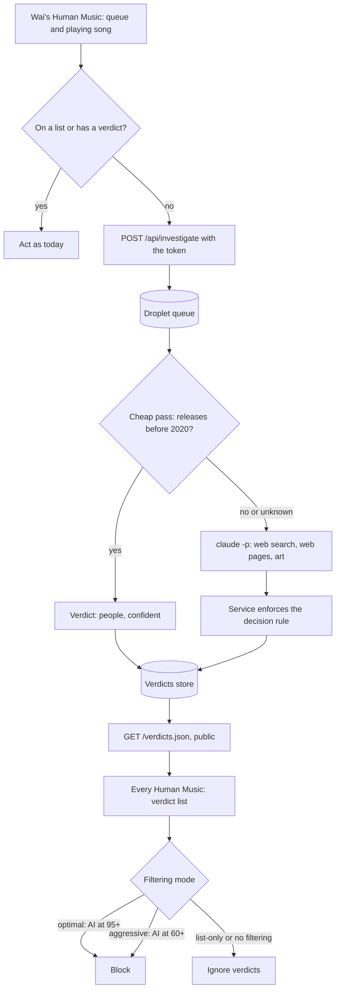

# AI investigator: design

Status: approved by Wai 2026-11-16 ("Looks good / Go").

## Why

The lists Human Music blocks from stop growing (Soul Over AI's newest entry is
from February), while new AI-generated artists keep appearing. Wai spots them
herself by their art and by having no history from before generative music
tools. The investigator does that spotting for her, a step ahead of playback,
and remembers every answer so no artist is investigated twice. Its findings
become a public list that every Human Music can use.

This brings back the checker designed on 2026-11-11
(`~/src/YTM-AI-Artist-Song-Blocker/docs/superpowers/specs/2026-11-11-ai-artist-checker-design.md`),
which was then moved out of the extension into a research tool. Wai's newer
target overrides that split for the sending part; the judging still happens
outside the extension.

## What Wai decided (2026-11-15/16)

- The feature: "it should look ahead in the queue, and checks if
  songs/artists post-2019 are AI when not on any list"; "save all findings
  with confidence level / this way, we don't need to search something
  multiple times".
- A uBlock Origin style setting with four stops: "no filtering / list-only /
  optimal, searches and blocks 95% confidence AI music / aggressive, blocks
  60%+ confidence".
- Who judges: "claude subscription". "we give it a URL to send all of a
  song/artist/album's metadata and album art / my claude subscription will
  investigate the AI level save it to its own storage and list with a
  confidence level".
- Who sends: "only my copy". Every other copy only reads the published list.
- Where: "on the droplet" (wai-lau.net), which also serves the list.

## Goals

1. Wai's copy sends every upcoming song whose artist no list and no verdict
   covers (title, artist, album, art link, artist IDs) to the investigator.
2. The investigator, on Wai's Claude subscription, decides per artist: AI,
   people, or unsure, with a confidence (0-100) and short reasons with sources.
   Artists with releases from before 2020 are settled as people cheaply,
   without a deep investigation ("post-2019").
3. Every verdict is stored on the droplet and never investigated again unless
   Wai asks.
4. The droplet publishes all verdicts as a list; every Human Music reads it.
5. The filtering mode decides what blocks: list-only ignores verdicts,
   optimal blocks AI verdicts at 95+, aggressive at 60+.
6. Blocking means what it means today: removed from the queue, skipped,
   hidden, greyed out, logged (with the confidence in the log reason).

## Non-goals

- Store users sending anything. Their copies never contact the investigator.
- Judging audio. The investigator reads public information and art; it may
  read Deezer's audio-based AI label where the web shows it.
- On-screen notices. The log stays the place to look.
- Contributions from other people to the verdict list (later, maybe).

## Anti-goals (failure even if it works)

- **Skipping a real person at "optimal".** 95 must mean that at most about 1
  in 20 such verdicts is wrong, checked against known artists before it ships
  (see Calibration). Aggressive (60) accepts more mistakes; people choose it.
- **Playback waiting on the investigator.** Sending is fire-and-forget; a
  slow, offline or broken investigator changes nothing about playback.
- **Burning the subscription.** One investigation per artist, ever; a daily
  cap; nothing from anyone but Wai's copy.
- **A page or a name steering the verdict.** Pages and metadata are data; the
  service enforces the decision rule, not just the prompt.

## How it works



### In the extension (every copy)

- **Filtering mode** replaces the Pause switch in the popup header: a
  four-stop slider like uBlock Origin's, labelled with the current stop.
  - No filtering: Human Music does nothing (today's Pause).
  - List-only: today's behaviour.
  - Optimal: list-only plus AI verdicts at 95 or more.
  - Aggressive: list-only plus AI verdicts at 60 or more.
  The setting `paused: true` migrates to No filtering.
- **The verdict list** is a second built-in filter list, "Human Music
  verdicts", fetched from the droplet like any list (refresh setting applies;
  the droplet sends `Access-Control-Allow-Origin: *`, so no new permission).
  Only entries with verdict `ai` matter; the mode's threshold picks which.
  People and unsure verdicts never override anything, and Never skip still
  wins over everything.
- **Matching** uses the artist IDs when the entry has them (Spotify artist
  ID, YouTube channel ID) and the name otherwise, like the lists today.
- **Log:** a verdict block shows its reason as "AI-generated · Human Music
  verdicts · 97%".

### In Wai's copy only (when an investigator token is set)

- **Sending.** Lookahead and the playing-song check collect artists that
  match no list entry and no verdict (any verdict, any confidence) and send
  them in small batches to `POST https://wai-lau.net/human-music/api/investigate`
  with `Authorization: Bearer <token>`. Each item: site, title, artist line
  and credited names, album, art URL, artist IDs when the page shows them.
  Each artist is sent at most once per day from a copy (kept in storage).
- **Fresh verdicts.** While it has artists waiting, Wai's copy re-reads the
  verdict list every few minutes instead of waiting for the daily refresh, so
  a verdict can act on the next song by that artist.
- **The token** is set in the popup (Behaviour, under "Investigator") and
  kept in its own storage key that only the worker and the popup read; the
  content script sees only an on/off setting (`investigate`). (Correction,
  Claude's call while planning: `setAccessLevel` limits the whole local
  storage area, which the content scripts must keep reading, so it can't
  shield one key. Pages can't read extension storage either way.) The worker
  does the sending, not the content script.

### On the droplet

- **A small HTTPS service** at `https://wai-lau.net/human-music/`:
  - `POST /api/investigate` (token): accepts a batch, answers at once
    (202), queues new artists, ignores known ones.
  - `GET /verdicts.json` (public, CORS open, cacheable): every verdict.
  - `GET /api/status` (token): queue length, today's count, last error.
- **A worker** takes one artist at a time:
  1. **Cheap pass:** look up the artist's release history (MusicBrainz and
     the like, or a short web search). Clear releases before 2020: verdict
     people, high confidence, no deep investigation.
  2. **Investigation:** `claude -p` on Wai's subscription, with only web
     search and web fetch, and Read inside a scratch folder holding the art
     (downloaded by the service from image hosts it trusts, size-capped). It
     returns JSON: verdict, confidence, signal ids, reasons, sources.
  3. **Decision rule, enforced by the service:** `ai` only with two
     different signals, or one strong one (a Deezer AI label, the artist's
     own disclosure, a tracker listing). The art never decides alone.
     Otherwise the verdict is `unsure`. Signals, in rough order of strength:
     Deezer AI label; no human footprint (no label, tours, interviews, real
     socials, credits naming people); a short, heavy catalogue starting 2024
     or later; AI-style art; tracker flags (SoullessMusic, SlopTracker,
     Spotify's AI badge, own disclosure).
- **Storage:** one SQLite file. A verdict per artist (keys: Spotify ID,
  YouTube channel ID, normalised name; merged when one artist shows up on
  both sites), with confidence, reasons, sources, model and date.
- **Limits:** one investigation at a time; a daily cap (start at 100,
  adjustable); requests over size or without the token are refused.
- **Runs as its own unprivileged user**, as a systemd service, with its own
  Claude Code login (Wai logs in once). The token lives in a root-readable
  environment file.

### Verdict list format

Human Music's list format plus the verdict fields:

```json
{
  "name": "Human Music verdicts",
  "updated": "2026-11-16T12:00:00Z",
  "artists": [
    { "name": "The Velvet Sundown", "spotifyId": "2GRtyAXWUiisGYub5SGMrb",
      "channelId": "UCLeR-eGh2OFy9ydX7IUcOTw", "verdict": "ai",
      "confidence": 98, "checked": "2026-11-16" }
  ]
}
```

Reasons and sources stay on the droplet (shown at
`/verdicts/<key>` for anyone who wants to check a verdict); the list carries
only what extensions need, to keep it small.

### Test cases (Wai, 2026-11-16)

Forrest Rose and The Broken Radios are AI-generated and on no list: the first
live run must find both as AI. They also join the calibration's known-AI set.

### Calibration

A model's "95" is not a probability. Before Optimal ships, the investigator
runs on a labelled sample: about 50 Soul Over AI artists (known AI) and about
50 artists known to be people who started 2020 or later. The service then
maps raw confidences so that "95" means at most about 1 wrong in 20 on that
sample, and "60" its own measured rate. The report goes to Wai. Until then,
verdicts are published but the Optimal and Aggressive stops say "not ready".

## Approaches considered

| | Chosen | Why not the others |
|---|---|---|
| Who judges | Wai's Claude subscription | The extension alone reaches 95% rarely; a per-user API key makes store users pay and send data. |
| Who sends | Only Wai's copy, with a token | Strangers' requests on a personal subscription risk Anthropic's terms, cost her usage, and need privacy work. |
| Where it runs | The droplet, always on, serving the list | WSL only runs while her PC is on; GitHub publishing adds a commit step. |

## Claude's calls (Wai can overrule)

- "No filtering" replaces Pause, in the header slider.
- Store copies default to Optimal once calibration passes; until then
  List-only.
- People and unsure verdicts never unblock anything a list blocks.
- Reasons and sources stay on the droplet, not in the list.
- Each artist is sent at most once a day from Wai's copy; the droplet
  investigates each at most once ever (Wai can ask for a re-check).
- The art is sent as a link; the droplet downloads it.

## Settled after the builder check (Claude's calls unless marked)

1. **What gets sent.** Queue rows give what they have: title, credited names,
   and artist IDs on Spotify (YouTube Music queue rows carry none, checked
   live). The playing song adds album and art (the player shows both). The
   investigator resolves a name-only item itself (search by name plus song
   title), and records the IDs it finds, so later items match by ID.
2. **Several credited artists.** One item per credited artist; each artist
   gets their own verdict. A song blocks if any credited artist has an AI
   verdict at the mode's threshold, the same rule lists use today. Mix cards
   keep today's rule (every credit must be listed).
3. **Name matches.** Verdict entries match by ID or by name, like the lists:
   Wai decided on 2026-11-13 to keep "name or ID" for namesakes (a real
   namesake goes on Never skip). When IDs are learned later, the stored
   verdict gains them; it is not investigated again.
4. **The cheap pass.** A pre-2020 release counts only when a source ties it
   to this artist (the same Spotify or YouTube ID, or one of the sent song
   titles in that discography). Anything less, or nothing found, goes to the
   deep investigation.
5. **The subscription on a server.** Wai chose her subscription on the
   droplet. She runs `claude setup-token` once there; the service uses that
   long-lived token. When the login lapses or a usage limit is hit, the
   worker pauses the queue (nothing is lost) and `/api/status` says why;
   there is no fallback model.
6. **The daily cap** counts deep investigations only (cheap passes are
   free). The queue carries over to the next day. The playing artist goes
   first, then lookahead artists in the order received.
7. **Unsure verdicts** are investigated again when the artist is sent again
   30 or more days later (new acts gain a history). AI and people verdicts
   stay until Wai asks: `POST /api/recheck` (token) with an artist key, and a
   small CLI on the droplet for the same.
8. **Calibration sample.** Known AI: 50 random Soul Over AI artists. Known
   people, chosen to look like the hard cases: 50 artists that began in 2020
   or later with a small catalogue and a real footprint (an independent label
   or Bandcamp page, live dates, named members), from MusicBrainz, plus any
   artist Wai has put on Never skip. If no mapping reaches 1 wrong in 20 at
   95, Optimal stays "not ready" (its slider stop is disabled with that
   note) and the decision rule tightens until it does. Claude runs it; Wai
   gets the report and decides when Optimal turns on.
9. **CORS without a new permission.** The service answers the worker's
   preflight with `Access-Control-Allow-Origin` set to the extension's own
   origin and `Access-Control-Allow-Headers: Authorization, Content-Type`;
   the public list sends `*`. No host permission is added, so store copies
   show no change. The existing list parser keeps the `verdict` and
   `confidence` fields; entries with neither keep working as before.
10. **Order of work.** The extension side first (slider, verdict list,
    sending code), tested against a hand-made verdicts file; then the
    droplet service; then calibration; then Optimal on.
11. **The droplet** (Wai's answer needed): see the open question.

## The droplet (looked at read-only, 2026-11-16)

| What | Found |
|---|---|
| System | Ubuntu 24.04, 2 CPUs, 2 GB memory (about 1.1 GB free), 54 GB disk free |

**Setup steps (each needs Wai's yes before it runs):**

1. A system user `human-music` (no login), its data in `/var/lib/human-music`.
2. The service code from this repo's `research/investigator/` in
   `/opt/human-music-investigator`, Node 22 standard library only (Node is
   there and matches the repo's tooling).
3. `/etc/human-music/env` (owner root, group human-music, mode 640) with the
   investigator token and `CLAUDE_CODE_OAUTH_TOKEN`, from `claude setup-token`
   that Wai runs once.
4. A systemd unit `human-music-investigator.service`: `User=human-music`,
   listening on `127.0.0.1:8140`, with `ProtectSystem=strict`,
   `ReadWritePaths=/var/lib/human-music`, `NoNewPrivileges=yes`,
   `PrivateTmp=yes`, a memory cap of 600 MB (exec-fn shares the machine).
5. In `/etc/nginx/sites-enabled/default`, a `location /human-music/` block
   proxying to `127.0.0.1:8140`, placed before `location /`; then `nginx -t`
   and a reload. exec-fn's rules stay as they are.


- The exact prompt and JSON schema for `claude -p`.
- Where the "known people" calibration sample comes from.
- The popup look of the slider and the investigator section (it follows the
  popup redesign of 2026-11-15).
