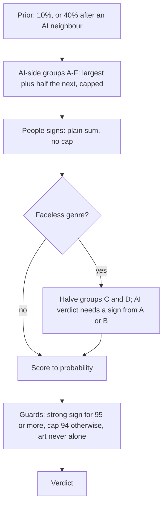

# What the investigator should look for, and how much each sign counts

Updated 2026-11-17. Research for Wai, not yet in code. Numbers marked
*(est.)* are my reasoned estimates, not published figures; everything else
carries a source link. Signal ids in `code` are the ones in
`research/investigator/src/answer.mjs` today; ids in *italics* are proposals.

Wai's ask (2026-11-17): "each thing that is being researched should assign
some percentage of the certainty / do some research for what to look out for
and how much each thing matters".

## In short

- **Each sign gets a likelihood ratio (LR):** how many times more often it
  shows up among AI-generated artists than among new artists made by people.
  The investigator adds the signs up as points (10 x log10 of the LR) on top
  of a starting prior, and the total turns into a percentage.
- **Starting prior: 10%** that an unknown artist reaching the investigator is
  AI-generated (range 3-20%), and **40%** when the song before it in the
  queue is by an AI-generated artist (section 2).
- **The strongest signs toward AI** are platform labels on the music
  (Deezer's tag, YouTube Music's new label), the artist's own statement that
  the music is AI-generated, and a reviewed tracker listing. Catalogue shape
  (dozens of albums a year since 2024) is the strongest of the rest.
- **The strongest signs toward people** are live shows confirmed by someone
  other than the artist, Spotify's Verified badge, a first release in
  2020-2023 with a date that can't be backdated, a Wikipedia article or press
  feature about people making the music, and named musicians in the credits.
- **The real false-positive danger is faceless music made by people:**
  pseudonymous lofi, ambient, café-jazz and production-music artists, who look
  like AI on every footprint test. Section 4 proposes discounting the
  footprint and catalogue signs in those genres, and requiring a label,
  disclosure or list sign there before any AI verdict.
- **New facts that bear on the design** (details in the sections below):
  - Soul Over AI stopped updating in March 2026 and moved to Zoundhub, which
    lists far more artists (7,762 flagged against 1,375).
  - Deezer's AI tag is not in Deezer's public API or its server-rendered
    pages, so the investigator can't see it with a plain fetch. Zoundhub's
    artist pages relay it.
  - YouTube Music began labelling AI songs on 2026-10-14.
  - Spotify added three things in 2026: a Verified badge for real artists
    (April), AI credits (April) and AI Persona badges (September).

## 1. How the numbers work

A likelihood ratio compares how often a sign appears in the two groups:

$$\mathrm{LR}(s) = \frac{P(s \mid \text{AI-generated})}{P(s \mid \text{made by people})}$$

LR above 1 points toward AI; below 1 toward people; 1 means the sign tells
nothing. To keep the arithmetic in whole numbers, each LR becomes **points**:

$$\text{points}(s) = 10 \log_{10} \mathrm{LR}(s)$$

| LR | Points | Reading |
|---|---|---|
| 100 | +20 | very strong toward AI |
| 30 | +15 | strong toward AI |
| 10 | +10 | medium toward AI |
| 3 | +5 | weak toward AI |
| 2 | +3 | very weak toward AI |
| 1 | 0 | no information |
| 0.3 | -5 | weak toward people |
| 0.1 | -10 | medium toward people |
| 0.03 | -15 | strong toward people |
| 0.01 | -20 | very strong toward people |

A total score $S$ (prior plus all signs) maps back to a probability:

$$P(\text{AI}) = \frac{1}{1 + 10^{-S/10}}$$

| Total points | P(AI) | Meaning for the extension |
|---|---|---|
| -9.5 | 10% | the starting prior |
| 0 | 50% | even |
| +1.8 | 60% | Aggressive line |
| +12.0 | 94% | today's cap without a strong sign |
| +12.8 | 95% | Optimal line |
| +20 | 99% | |

So from the 10% prior, an artist needs **+11.3 points** of evidence to reach
60 and **+22.3** to reach 95.

## 2. The starting prior

The question: of the artists that reach the investigator (on no list, no
release before 2020 found, heard in Wai's YouTube Music queue), what share
are AI-generated? No source measures that population directly. Four anchors
bracket it.

| Anchor | Figure | Source |
|---|---|---|
| Share of new **tracks** uploaded that are fully AI | 10% (Jan 2025), 39% (Jan 2026), 44% (Apr 2026), over 50% at the June 2026 peak, on Deezer | [TechCrunch](https://techcrunch.com/2026/07/21/music-streamer-deezer-says-more-than-50-of-daily-uploads-are-ai-generated/), [Deezer Apr 2026](https://newsroom-deezer.com/2026/04/ai-generated-tracks-represent-44-of-new-uploaded-music/), [Deezer Jul 2026](https://newsroom-deezer.com/2026/07/ai-music-exceeds-50-percent-daily-uploads-deezer/) |
| Same, by SubmitHub's own detector, July 2026 releases | 23.2% fully AI, 15.3% AI audio reworked by people | [Euronews](https://www.euronews.com/culture/2026/08/20/alarming-study-reveals-that-almost-40-per-cent-of-music-released-globally-in-july-2026-use) |
| Share of **active artists** that are AI (Spotify, late 2025) | about 14% *(my arithmetic)*: 202,046 AI and 238,646 human tracks in the week of 2025-11-03, with AI musicians releasing about 5 tracks a month and people about 1 | [Wu et al., UChicago, arXiv 2606.18052](https://arxiv.org/html/2606.18052) |
| Share of **listening** that is AI | 1-3% of Deezer streams, of which up to 70% (2026) to 85% (2025) is fraudulent; 1.2% of tracks in Spotify's recommendation graph; 0.3% of Spotify royalties | [Deezer Jul 2026](https://newsroom-deezer.com/2026/07/ai-music-exceeds-50-percent-daily-uploads-deezer/), [Wu et al.](https://arxiv.org/html/2606.18052) |

What moves the investigator's population away from these anchors:

- **It is listening-weighted, which pulls the share down** toward the 1-3%
  anchor. AI tracks are mostly unheard: 92.7% of AI tracks got negligible
  plays from January to May 2026, against 67.5% of tracks made by people
  ([Wu et al.](https://arxiv.org/html/2606.18052)).
- **The pre-2020 pass pulls it back up.** Long-running human artists never
  reach the investigator, so AI artists are a much larger share of what's
  left. If about a third of the distinct artists in a queue started in 2020
  or later *(est.)*, a 2-3% AI share among all artists becomes 6-10% among
  the new ones.
- **Lists pull it down.** The best-known AI artists are already on
  subscribed lists and never reach the investigator.
- **YouTube Music doesn't demote AI.** Its new label "alone does not affect
  recommendations" ([RouteNote](https://routenote.com/radar/youtube-music-adds-ai-labels-to-songs-heres-what-they-mean/)),
  while Deezer drops tagged AI from recommendations
  ([Deezer](https://newsroom-deezer.com/2026/07/ai-music-exceeds-50-percent-daily-uploads-deezer/))
  and Spotify keeps AI Personas out unless a listener seeks them out
  ([Spotify](https://support.spotify.com/us/artists/article/ai-personas/)).
  So a YouTube Music queue probably carries more AI than the Deezer stream
  share suggests.
- **AI clusters in recommendations.** On Spotify, 93% of AI tracks
  recommend other AI tracks, about 40% of their recommendations are AI, and
  84% of human tracks recommend no AI at all
  ([Wu et al.](https://arxiv.org/html/2606.18052)).

**Proposal:**

- **10%** for an unknown artist (-9.5 points). The range runs from 3% (the
  listening anchor) to 20% (above the uploading-artist anchor), and the
  worked examples below show the effect of the range.
- **40%** (-1.8 points) when the previous song in the queue, or the radio's
  seed, is by an artist that is listed or judged AI-generated. That is the
  clustering figure above.
- Both of Wai's first live cases, Forrest Rose and The Broken Radios, came
  out AI, but two cases are an anecdote, not a measurement.
- To measure the prior: after a few hundred investigations, count the share
  of confident verdicts that are AI and adjust (section 8).

## 3. The signs

Each table gives:

- **Where to check:** the page that shows the sign, and its **cost**. Cheap
  is one structured fetch; medium is a few searches plus reading; expensive
  needs a separate model call or a paid API.
- **Among AI** and **among new people:** how often the sign appears in each
  group.
- **LR (points):** the proposed weight.
- **What misleads:** the main way the sign fires on a real person.

"New people" means artists made by people whose first release is in 2020 or
later.

### 3.1 Strong signs toward AI

| # | Sign | Where to check (cost) | Among AI | Among new people | LR (points) | What misleads |
|---|---|---|---|---|---|---|
| S1 | Deezer "AI-generated content" tag on the artist's own main catalogue (`deezer_ai_label`) | Deezer app or rendered page; Zoundhub artist page relays it as "Deezer AI flag: Found" (cheap via Zoundhub) | about 85% *(est.)* | 0.5% or less *(est.)* | 100 (+20) | an AI track uploaded onto a real artist's profile; same-name profiles merged; one experiment among human work |
| S2 | The artist says the music is AI-generated (`own_disclosure`) | streaming bio, official site, linked socials, Spotify AI credits for vocals and composition, YouTube channel description (cheap) | 20-30% *(est.)* | about 0.2% *(est.)* | 100 (+20) | misreading "no AI" or "human-made"; AI used only for mastering or art; hoax statements by people not tied to the artist |
| S3 | YouTube Music AI label on a song by this artist (*`youtube_ai_label`*) | YouTube Music player page, under the title; the extension can read it in the page (cheap) | unknown; new since 2026-10-14 | unknown, likely low | 30 (+15); 100 (+20) if the panel says the label came from the label or distributor | unmeasured detector; a missing label proves nothing |
| S4 | Listed by a tracker that reviews entries and shows its evidence (`tracker_listing`, curated) | Zoundhub (rating 4-5), SoullessMusic; Soul Over AI, though it is frozen (cheap) | depends on coverage | low but not zero | 30 (+15) | a list that only relays Deezer or SH Labs, which would count the same evidence twice; disputed entries |

Notes:

- **S1, Deezer tag.** Deezer has tagged albums containing fully AI tracks
  since June 2025, drops them from algorithmic and editorial
  recommendations ([Deezer 2025](https://newsroom-deezer.com/2025/06/deezer-just-rolled-out-the-world-s-first-ai-music-tagging-system/)),
  and tags at album level. It claims 99.8% accuracy and fewer than 1 false
  positive per 10,000 human tracks, and tagged 13.4 million tracks in 2025
  ([Deezer 2026](https://newsroom-deezer.com/2026/07/ai-music-exceeds-50-percent-daily-uploads-deezer/)).
  - **Its method:** it finds frequency artifacts left by the decoders in
    generative models (an ISMIR 2025 best paper,
    [program page](https://ismir2025program.ismir.net/poster_229.html)).
  - **Why the LR is held at 100, below the vendor's claim:**
    - Vendor claims run far above independent tests. IRCAM claims 98.5%
      ([MBW](https://www.musicbusinessworldwide.com/icram-amplify-unveils-ai-tool-to-detect-ai-generated-music/)),
      but an independent study had it call 4.7% of human recordings AI
      (non-AI recall 0.953 on 150 tracks), and it was fooled by resampling to
      22.05 kHz ([Cros Vila et al., TISMIR](https://transactions.ismir.net/articles/10.5334/tismir.254)).
    - Deezer missed the UChicago team's own uploads made with open-source
      models ([Wu et al.](https://arxiv.org/html/2606.18052)).
    - AI tracks have been uploaded onto real artists' profiles: Blaze
      Foley's, via SoundOn, in 2025
      ([The FADER](https://www.thefader.com/2025/07/22/spotify-ai-generated-blaze-foley-song)).
  - **Rule:** count S1 only when the tagged releases are this artist's main
    catalogue (matched by IDs, not name). A single tagged release among
    older human ones scores +5 and points to an impersonation upload.
  - **How to see it:** the public API and the server page don't carry the
    tag. Checked 2026-11-17: no AI field in
    [api.deezer.com/album/768162921](https://api.deezer.com/album/768162921)
    (The Velvet Sundown, which Deezer flagged per
    [Wikipedia](https://en.wikipedia.org/wiki/The_Velvet_Sundown)) or in its
    [web page](https://www.deezer.com/en/album/768162921). Zoundhub's
    server-rendered artist page shows "Deezer AI flag: Found"
    ([example](https://zoundhub.com/artist/molly-brooks)).
- **S2, disclosure.** The Velvet Sundown changed its Spotify bio to a
  "synthetic" project after a "spokesman" who wasn't tied to the band
  claimed it was a Suno hoax
  ([Wikipedia](https://en.wikipedia.org/wiki/The_Velvet_Sundown)).
  - **A denial is weak evidence.** In SubmitHub's July 2026 data, 31% of
    artists whose tracks were flagged for AI audio said they used no AI
    ([Hypebot](https://www.hypebot.com/submithub-ai-music-detector-exposes-huge-disclosure-gap.md)).
  - **AI credits:** Spotify's show only when the artist opts in through a
    label or distributor, and describe a contribution, not a fully AI track
    ([MBW](https://www.musicbusinessworldwide.com/spotify-to-show-ai-tags-in-song-credits-where-artists-have-chosen-to-disclose-through-their-label-or-distributor/)).
    Only credits that cover vocals and composition count as S2; mastering
    or lyrics alone score 0.
  - **Apple:** its Transparency Tags (March 2026) are optional and
    self-declared ([TechRepublic](https://techrepublic.com/article/news-apple-music-transparency-tags-ai-music)),
    so they count as disclosure when present.
- **S3, YouTube Music label.** Launched 2026-10-14 on the player page, for
  songs "created primarily using generative AI"; YouTube combines partner
  information with its own detection
  ([YouTube blog](https://blog.youtube/news-and-events/youtube-music-ai-labels/)).
  Partners pick Fully Gen AI, Partly Gen AI or No Gen AI, and a missing
  label shouldn't be read as human-made
  ([RouteNote](https://routenote.com/radar/youtube-music-adds-ai-labels-to-songs-heres-what-they-mean/)).
  No accuracy has been published, so it starts below S1. It is the cheapest
  strong sign for Human Music, because the extension is already on that
  page; the selector needs a live check per the repo rules.
- **S4, trackers.** Lists differ a lot:
  - **Soul Over AI** works from community submissions with "a manual
    review process" ([repo](https://github.com/xoundbyte/soul-over-ai)). It
    stopped its scheduled build on 2026-03-04 and points to Zoundhub
    ([commits](https://github.com/xoundbyte/soul-over-ai/commits/main));
    its `dist/artists.json` holds 1,375 artists.
  - **Zoundhub** combines "platform labels, third-party analysis and release
    metadata" and calls a listing "a starting point for investigation"
    ([repo](https://github.com/xoundbyte/zoundhub)). It shows 9,496 artists,
    7,762 of them flagged with a rating of 4 or 5 ([site](https://zoundhub.com/)),
    and says its rating is "a Zoundhub heuristic, not a probability"
    ([artist page](https://zoundhub.com/artist/molly-brooks)).
  - **SoullessMusic** runs open detectors (SONICS, a vocoder fingerprint),
    checks metadata and Wikipedia, and reviews submissions by hand; its
    maker expects false positives
    ([404 Media](https://404media.co/spotifys-ai-problem-is-so-bad-random-people-are-stepping-in-to-track-the-slop)).
  - **SlopTracker** is detector-led and removed one act after a legal
    notice ([AI Musicpreneur](https://www.aimusicpreneur.com/ai-music-news/soullessmusic-sloptracker-spotify-ai-labeling-gap/)).
  - **Cevval's list** states no criteria at all
    ([README](https://github.com/cevvalkoala/CevvalYoutubeAIBlocklist)).

  So count S4 only for lists with review and evidence. Detector-only lists
  go in M2, and a list entry that rests on the Deezer tag adds nothing when
  S1 is already counted.

### 3.2 Medium signs toward AI

| # | Sign | Where to check (cost) | Among AI | Among new people | LR (points) | What misleads |
|---|---|---|---|---|---|---|
| M1 | Spotify AI Persona badge: self-disclosed / "Likely AI Persona" (*`ai_persona_badge`*) | Spotify artist page and Now Playing (cheap if the web page shows it; not checked) | AI acts with a photoreal persona | people with a photoreal AI avatar who make the music themselves | 20 (+13) / 10 (+10) | the badge covers the image, not the music |
| M2 | Detector-led tracker, or Zoundhub rating without the Deezer flag (`tracker_listing`, detector) | SoullessMusic, SlopTracker, Zoundhub (cheap) | high | 3-8% *(est.)* | 8 (+9) | synth, darkwave and heavily produced music trip detectors |
| M3 | SH Labs at 85 or more on two tracks | SH Labs, already stored for comparison (expensive: quota) | 66% of Deezer-flagged artists score 85 or more | 3-6% *(est.)* | 10 (+10) | 30-second previews; synth and electronic music; per the spec, comparison only |
| M4 | 10 or more albums in some 12 months since 2024 (`short_heavy_catalogue`, top tier) | Deezer API album list, MusicBrainz (cheap) | 25-35% *(est.)* | 0.5% or less *(est.)* | 25 (+14) | an older artist uploading a back catalogue at once; kids', Christmas and meditation series |
| M5 | 5-9 albums in 12 months since 2024, or 3 albums within 3 months (`short_heavy_catalogue`) | same (cheap) | about 20% *(est.)* | 1-2% *(est.)* | 10 (+10) | beat tapes, ambient and noise artists, mixtapes |
| M6 | No person found after a full search: no socials showing a person, no live dates, no press, no credits beyond the artist name (`no_human_footprint`) | web search, socials, Songkick or Bandsintown, setlist.fm, press (medium) | 60-70% *(est.)* | 5-10% *(est.)* | 8 (+9) | faceless producers (see 3.5); a search that wasn't actually run |
| M7 | The same obscure person credited as writer across many unrelated artist profiles (*`operator_credit`*) | Deezer album page credits, Spotify credits (medium) | 10-20% *(est.)* | about 2% *(est.)* | 5 (+7) | production-music writers behind many pseudonyms |
| M8 | No Spotify Verified badge despite 10,000+ monthly listeners for 3+ months (*`unverified_at_scale`*) | Spotify artist page (cheap if visible; not checked) | nearly all AI with that audience | 20-30% *(est.)* | 4 (+6) | a real artist who hasn't linked socials or concerts yet |
| M9 | Photoreal artist photos with AI artifacts (*`persona_photo_ai`*) | artist image, socials (expensive: separate image look) | about 40% *(est.)* | about 5% *(est.)* | 5 (+7) | filters, retouching, AI-edited press shots |

Notes:

- **M1, AI Persona badge.** Spotify defines an AI Persona as an artist
  whose public identity "represents an AI-generated photorealistic human".
  - Spotify can apply a "Likely AI Persona" badge after reviewing the name
    and imagery, album art included; artists can appeal
    ([Spotify for Artists](https://support.spotify.com/us/artists/article/ai-personas/)).
  - "The badge doesn't mean that the music itself was AI-generated"
    ([Spotify](https://support.spotify.com/uk/article/ai-persona-badge/)).
    That keeps M1 below S2.
  - Rollout began in mid-September 2026
    ([Mixdown](https://mixdownmag.com.au/news/spotify-rolls-out-an-ai-persona-badge-for-ai-generated-artists/)).
- **M2 and M3, detectors.** These are correlated with S1 and with each
  other, so section 4 counts only the largest of them.
  - **SH Labs on the Zoundhub data** (9,496 artists, downloaded 2026-11-17
    from [artists-all.json](https://zoundhub.com/data/artists-all.json)):
    65.6% of Deezer-flagged artists scored 85 or more, and only 3.3% scored
    under 50. Among listed artists without a Deezer flag, 25.7% scored 85 or
    more.
  - **Known AI acts sit in between:** The Velvet Sundown 71.7, Xania Monet
    84.6, Breaking Rust 88 (same file). So the 85 line misses a lot.
  - **It also fires on people.** SubmitHub flagged all 23 hand-made covers
    by Coloured Tears, and 1980s Twice a Man recordings, when checked
    through YouTube links ([AI Musicpreneur](https://www.aimusicpreneur.com/ai-music-news/ai-detector-false-positives-coloured-tears-twice-a-man-submithub-2026/)).
    Synth, darkwave and post-punk are the risky genres
    ([RouteNote](https://routenote.com/blog/?p=109048)).
- **M4 and M5, catalogue.**
  - **People:** active human artists average about 1 track a month, with
    50+ days between releases ([Wu et al.](https://arxiv.org/html/2606.18052)).
  - **AI musicians** average about 5 tracks a month, 16 days apart, and
    "spray and pray" across genres; one uploaded over 60,000 tracks
    ([Wu et al.](https://arxiv.org/html/2606.18052)).
  - **In the Zoundhub data (Deezer-flagged artists):** median 10.5 releases
    a year since debut; 52% release 10 or more a year, 31% 20 or more, 11%
    50 or more; only 16.9% release fewer than 3 a year (my analysis of
    [artists-all.json](https://zoundhub.com/data/artists-all.json)).
  - **Count albums, not releases.** Many people release a single every few
    weeks, so release counts overlap; full albums every week don't.
  - **Examples:** The Velvet Sundown put out three 13-track albums in 39
    days (2025-06-05, 06-20, 07-14:
    [1](https://api.deezer.com/album/768162921),
    [2](https://api.deezer.com/album/774152711),
    [3](https://api.deezer.com/album/784783191)). Sienna Rose put out at
    least 45 songs and ten albums from September to December 2025, which
    *NME* called "implausible"
    ([Wikipedia](https://en.wikipedia.org/wiki/Sienna_Rose)).
  - **Prolific people exist,** but are "rare" among new artists
    ([Android Authority](https://www.androidauthority.com/how-to-spot-ai-music-3637174/)).
- **M6, footprint.**
  - **People:** 86% of independent artists make social content to promote
    their music, and 51% played a live show in the past 12 months (Ditto,
    5,039 artists, [2026 report](https://dittomusic.com/en/independent-music-report-2026)).
    So a real new artist with nothing findable is uncommon, but not rare.
  - **AI acts:** The Velvet Sundown had "no records of any performances"
    and members with no social media
    ([Wikipedia](https://en.wikipedia.org/wiki/The_Velvet_Sundown)); Sienna
    Rose had "never performed live" and gave no interviews
    ([Wikipedia](https://en.wikipedia.org/wiki/Sienna_Rose)).
  - **But an AI persona can have a big social presence:** Breaking Rust has
    about 100k Instagram followers, all AI imagery
    ([Wikipedia](https://en.wikipedia.org/wiki/Breaking_Rust)). Count
    socials as human only when they show a real person (P5).
- **M7, operator credit.** Breaking Rust is credited to Aubierre Rivaldo
  Taylor, who earlier made AI country as Defbeatsai
  ([Wikipedia](https://en.wikipedia.org/wiki/Breaking_Rust)). The
  look-alike human pattern: about 20 songwriters behind more than 500
  "ghost" profiles in Spotify's mood playlists
  ([The FADER](https://www.thefader.com/2024/12/19/report-spotify-is-populating-its-playlists-with-ghost-artists)).
- **M8, Verified badge.**
  - **Criteria:** 10K monthly listeners over three months, 1K followers,
    and "public markers of authenticity" (linked socials, concert dates,
    merch). Profiles that appear to "primarily represent AI-generated or
    AI-persona artists are not eligible"
    ([Spotify](https://support.spotify.com/artists/article/verified-by-spotify/)).
  - **Reach:** at the April 2026 launch, more than 99% of artists that
    listeners actively search for were verified; a missing badge doesn't
    prove an artist isn't real
    ([Techloy](https://www.techloy.com/spotify-introduces-verified-by-spotify-to-identify-real-human-artists.md)).
  - **Who it applies to:** 32% of Deezer-flagged artists in Zoundhub have
    10,000+ monthly listeners (my analysis), so this check covers about a
    third of AI artists. Under that audience size, a missing badge means
    nothing (LR 1).

### 3.3 Weak signs toward AI

| # | Sign | Where to check (cost) | Among AI | Among new people | LR (points) | What misleads |
|---|---|---|---|---|---|---|
| W1 | First release 2024 or later, no earlier trace (*`start_2024_plus`*) | Deezer API, MusicBrainz (cheap) | 92.4% of Deezer-flagged artists | 45-50% *(est.)* | 2 (+3) | half of all new people started then too |
| W2 | Four or more unrelated genres in 12 months (*`genre_hopping`*) | Deezer API genre ids (cheap) | about 30% *(est.)* | about 10% *(est.)* | 2 (+3) | genre tags are set by the uploader and noisy; producers and cover artists range widely |
| W3 | A little footprint, but no person: an image-only social account, a link page (`no_human_footprint`, thin) | socials (medium) | about 25% *(est.)* | about 10% *(est.)* | 2.5 (+4) | shy or new artists |
| W4 | AI-style cover art (`ai_style_art`) | separate image look (expensive) | about 75% *(est.)* | about 25% *(est.)* | 2.5 (+4) | cover art is the second most common AI use among independent artists |
| W5 | No bio, or a stock, generic-sounding bio | streaming artist page (cheap) | about 70% *(est.)* | about 40% *(est.)* | 1.7 (+2) | many small artists never write one; people use chatbots for bios |
| W6 | Monthly listeners far above followers; streams from a few anonymous playlists | Spotify page, playlist list (medium) | about 30% *(est.)* | about 12% *(est.)* | 2 (+3) | playlist-driven people (lofi, ghost artists) look the same |
| W7 | Many near-identical short tracks | track list (cheap) | *(est.)* | *(est.)* | 1.5 (+2) | lofi and ambient people make 2-minute tracks too |
| W8 | Label field is the artist's own name or blank | Deezer API `label` (cheap) | about 80% *(est.)* | about 65% *(est.)* | 1.2 (+1) | most new people self-release |
| W9 | Random or generic name; bland lyrics; it sounds off | listening, lyrics (expensive) | | | about 1 (0-1) | not worth checking |

Notes:

- **W1.** AI-generated albums "do not predate 2024": Suno launched in
  December 2023 and Udio in April 2024
  ([Android Authority](https://www.androidauthority.com/how-to-spot-ai-music-3637174/)).
  AI tracks were under 1% of weekly new releases in January 2024 and over
  40% by November 2025 ([Wu et al.](https://arxiv.org/html/2606.18052)).
  The 92.4% comes from my analysis of
  [artists-all.json](https://zoundhub.com/data/artists-all.json): 3.7% of
  those artists debut in 2020-2023 and 3.9% before 2020.
- **W2.** The most varied 1% of AI musicians cover more than 12 genres;
  people mostly stay in one ([Wu et al.](https://arxiv.org/html/2606.18052)).
- **W4.** 47% of independent artists use AI somewhere in making music, and
  cover art is the second most common use
  ([Ditto](https://dittomusic.com/en/independent-music-report-2026)). That
  is why the art is weak and never decides alone (as the spec already says).
- **W6.** Fully AI tracks draw a large share of fraudulent streams: up to
  70% now, 85% in 2025
  ([Deezer](https://newsroom-deezer.com/2026/07/ai-music-exceeds-50-percent-daily-uploads-deezer/)).
  Spotify's spam filter targets "mass uploads, duplicates, SEO hacks,
  artificially short track abuse"
  ([Spotify](https://newsroom.spotify.com/2025-09-25/spotify-strengthens-ai-protections/)).
  But ghost artists ride the same playlists
  ([The FADER](https://www.thefader.com/2024/12/19/report-spotify-is-populating-its-playlists-with-ghost-artists)).
- **W9.**
  - **People can't hear it:** 97% couldn't tell fully AI music from music
    made by people in a blind test (Ipsos for Deezer, 9,000 people,
    [Deezer](https://newsroom-deezer.com/2026/07/ai-music-exceeds-50-percent-daily-uploads-deezer/)).
  - **Detection by ear depends on the generator:** listeners caught 82% of
    Suno v3.5 clips but only 23% of one Udio model's
    ([SONICS, arXiv 2408.14080](https://arxiv.org/abs/2408.14080v1)).
  - **Names don't help:** the streaming-fraud case against Michael Smith
    used randomly generated artist names such as "Calypso Xored"
    ([BleepingComputer](https://www.bleepingcomputer.com/news/security/musician-charged-with-10m-streaming-royalties-fraud-using-ai-and-bots/)),
    but people choose odd names too.
- **Distributors don't help either.** Nine of eleven independent
  distributors approved nearly all of a research team's AI uploads; only
  Horus (1 of 8) and RouteNote (0 of 8) didn't
  ([Wu et al.](https://arxiv.org/html/2606.18052)). LR about 1.

### 3.4 Signs toward people

| # | Sign | Where to check (cost) | Among AI | Among new people | LR (points) | What misleads |
|---|---|---|---|---|---|---|
| P1 | A release before 2020 (`pre_2020_release`) | MusicBrainz cheap pass (cheap) | 3.9% of Deezer-flagged artists show one | not applicable (the pass) | verdict people | backdated "original release dates"; same-name merges |
| P2 | First release in 2020-2023 (*`start_2020_2023`*) | YouTube upload date, Bandcamp, archived page, press (hard date); streaming date (soft) (cheap) | 3.7% of Deezer-flagged artists | about 50% *(est.)* | hard date 0.08 (-11); streaming date only 0.15 (-8) | backdating |
| P3 | Live shows confirmed by someone else: venue or ticket listing, local press, setlist.fm, fan video (*`live_verified`*) | web search (medium) | 1% or less *(est.)* | about 35% *(est.; 51% played live last year)* | 0.03 (-15) | a fabricated listing; a human singer fronting an AI project |
| P4 | Show dates listed only by the artist (Bandsintown, Songkick) (*`live_listed`*) | same (cheap) | about 3% *(est.)* | about 30% *(est.)* | 0.3 (-5) | listings can be wrong or invented |
| P5 | Real video of the person or band playing or talking, with a history and other people around (*`performance_video`*) | socials, YouTube (medium) | about 3% *(est.)* | 50-60% *(est.)* | 0.15 (-8) | AI video is improving; prefer older footage and footage from others |
| P6 | Press feature, interview or radio session where the musicians talk about making the music (*`press_feature`*) | web search (medium) | 1-2% *(est.)* | 15-25% *(est.)* | 0.1 (-10) | press about an AI act; count only press showing people making the sound |
| P7 | Wikipedia article, with independent sources, about people making the music (*`wikipedia_people`*) | Wikipedia (cheap) | about 0% | 2-5% *(est.)* | 0.05 (-13) | AI acts have Wikipedia articles too: read them |
| P8 | Established label with a roster of artists made by people (*`label_roster`*) | label site, roster (medium) | about 3% *(est.)* | about 20% *(est.)* | 0.25 (-6) | labels have signed AI acts |
| P9 | Credits naming several different people (producer, mixer, players) who have their own footprints (*`credits_people`*) | Deezer album page credits, Spotify credits, liner notes (medium) | about 5% *(est.)* | about 35% *(est.)* | 0.15 (-8) | a lyricist behind an AI voice |
| P10 | Physical release (vinyl, CD, cassette) with photos or a shop listing (*`physical_release`*) | Discogs, label shop, Bandcamp merch (medium) | about 2% *(est.)* | about 15% *(est.)* | 0.15 (-8) | Discogs is user-entered |
| P11 | Releases on Bandcamp, which has banned AI music since 2026-01-13 (*`bandcamp`*) | Bandcamp search (cheap) | about 5% *(est.)* | about 30% *(est.)* | 0.25 (-6) | enforcement runs on reports |
| P12 | Spotify Verified badge (*`spotify_verified`*) | Spotify artist page (cheap if visible; not checked) | about 1% *(est.)* | about 75% of those with 10K+ listeners *(est.)* | 0.03 (-15) | a review mistake |
| P13 | Human pace: fewer than 3 releases a year, months apart (*`normal_cadence`*) | Deezer API (cheap) | 16.9% of Deezer-flagged artists | about 50% *(est.)* | 0.35 (-5) | slow AI accounts exist |
| P14 | Members with a documented life outside the project: other bands, orchestras, schools, earlier projects (*`member_history`*) | web search (medium) | about 2% *(est.)* | about 30% *(est.)* | 0.15 (-8) | a real person running an AI project |
| P15 | Artist says no AI is used | bio, socials (cheap) | 30% of flagged submitters said so | common *(est.)* | 0.8 (-1) | denial is cheap |
| P16 | SH Labs under 50 on two tracks (only if Wai allows this use) | SH Labs (expensive) | 3.3% of Deezer-flagged artists | about 70% *(est.)* | 0.2 (-7) | generators SH Labs can't hear; selection bias in the 3.3% |

Notes:

- **P1, release before 2020.** DistroKid's upload form lets an uploader
  mark music "previously released" and enter an original release date
  ([DistroKid help](https://support.distrokid.com/hc/en-us/articles/4407879306643-Understanding-the-Upload-Form)).
  - **A concrete case:** Zoundhub's record for Sienna Rose's main Spotify
    profile (`6wq8iklwcF2dj0jtMpPvOJ`) gives a debut of 2019
    ([artists-all.json](https://zoundhub.com/data/artists-all.json)), yet
    her first release was a September 2025 EP
    ([Wikipedia](https://en.wikipedia.org/wiki/Sienna_Rose)). Whatever the
    cause, it is the kind of record that slips past a pre-2020 rule.
  - **How big the leak is:** 3.9% of Deezer-flagged artists in the Zoundhub
    data show a debut before 2020. That fails safe (the song plays), but it
    is why P2 prefers dates that can't be backdated: YouTube upload dates,
    Bandcamp dates, archived pages, press.
- **P3 and P4, live shows.** Only 51% of independent artists played live
  in the past year, and 61% of those played 5 shows or fewer
  ([Ditto](https://dittomusic.com/en/independent-music-report-2026)). So
  "no shows found" is weak toward AI (it is inside M6), while confirmed
  shows are strong toward people. One AI-looking page listed a show that
  turned out to be an error
  ([Android Authority](https://www.androidauthority.com/how-to-spot-ai-music-3637174/)),
  which is why artist-only listings get just -5.
- **P6 and P7, press.** AI acts get press and Wikipedia articles: The
  Velvet Sundown, Breaking Rust, Sienna Rose, Xania Monet. Read the article,
  and count it only when it shows people singing or playing.
- **P8, labels.** Hallwood Media signed the Suno-made act Xania Monet for
  a reported $3 million ([Wikipedia](https://en.wikipedia.org/wiki/Xania_Monet))
  and the human Suno creator imoliver
  ([The FADER](https://www.thefader.com/2025/07/25/imoliver-human-ai-music-designer-signed-record-deal)).
  So a label is people evidence only when its roster is people.
- **P9, credits.** "AI tracks often list only one person" in the credits,
  while bands credit each member
  ([Android Authority](https://www.androidauthority.com/how-to-spot-ai-music-3637174/)).
  But Xania Monet's lyrics are written by a person, Telisha Jones, over
  music made with Suno
  ([Wikipedia](https://en.wikipedia.org/wiki/Xania_Monet)). Several
  different credited people with their own footprints are what counts.
  Deezer's album page shows writer and composer credits in its server HTML
  ([example](https://www.deezer.com/en/album/768162921)).
- **P11, Bandcamp.** The ban covers music made "wholly or mostly" by AI and
  impersonation; users report suspects
  ([MBW](https://www.musicbusinessworldwide.com/bandcamp-bans-ai-generated-music-we-want-musicians-to-keep-making-music)).
- **P12, Verified.** See M8 for the criteria.
- **P16, low SH Labs scores.** SH Labs' terms forbid using a result as the
  only basis for a decision against a person (spec). Using a low score only
  to lower an AI verdict isn't a decision against a person, but that is
  Wai's call; until then it stays comparison-only.

### 3.5 Traps (not signs, but the main ways to get a person wrong)

- **Faceless music made by people.** Spotify's "Perfect Fit Content":
  about 20 songwriters behind more than 500 near-empty artist profiles in
  lofi, jazz, ambient and classical playlists (Deep Focus, Ambient
  Relaxation, Cocktail Jazz, Bossa Nova Dinner)
  ([The FADER](https://www.thefader.com/2024/12/19/report-spotify-is-populating-its-playlists-with-ghost-artists)).
  These are people, and they fail M6, M7, W3, W5 and W6. The same goes for
  production-music composers and many bedroom producers.
- **Same-name profiles.** 2.7% of Zoundhub's artists share a normalised
  name with another listed artist; there are three Breaking Rust profiles
  ([artists-all.json](https://zoundhub.com/data/artists-all.json), my
  analysis). Deezer's search for "Forrest Rose" returns 12 near-name
  artists ([API](https://api.deezer.com/search/artist?q=Forrest%20Rose)).
  Anchor on the platform IDs and cross-links; a name match alone carries no
  evidence across.
- **AI uploads on real profiles.** The Blaze Foley case above. A real
  artist with one odd tagged release is a victim, not an AI artist.
- **Unknown is not absent.** "No live shows" counts only if the
  investigator actually searched; it should record which checks ran.
- **Hybrid work.** 11% of independent artists say they have made fully AI
  music, and 47% use AI somewhere
  ([Ditto](https://dittomusic.com/en/independent-music-report-2026)). But
  fewer than 0.27% of human artists switched to releasing AI tracks
  ([Wu et al.](https://arxiv.org/html/2606.18052)). A long-running human
  profile with one AI release stays human.

## 4. How to combine them

Signs that come from the same underlying fact must not be multiplied as if
independent. Twelve "nothing found" checks are one fact: nobody found a
person. So the AI-side signs sit in groups. Within a group, take the largest
points plus half of the second largest, drop the rest, then apply the
group's cap. People-side signs simply add up, with no cap: that tilts every
close call toward play.

| Group | Members | Cap |
|---|---|---|
| A. Labels and disclosure | S1, S2, S3, M1 | +30 |
| B. Lists and detectors | S4, M2, M3; adds at most +3 if group A has S1 | +15 |
| C. Catalogue shape | M4, M5, W1, W2, W7 | +15 |
| D. Missing footprint | M6, M7, M8, W3, W5, W8 | +10 |
| E. Presentation | W4, M9, W9 | +7 |
| F. Listening pattern | W6 | +3 |
| People | P2-P16 | none |

$$S = 10\log_{10}\frac{p_0}{1-p_0} \;+\; \sum_{g \in A..F} \min\!\big(\text{cap}_g,\ \text{top}_g + \tfrac12\,\text{second}_g\big) \;+\; \sum \text{people points}$$

Guards (most already in `answer.mjs`):

1. **Unknown scores 0.** Absence signs (group D, "no live shows") count only
   when the check ran and is recorded.
2. **95 or more needs a strong sign** (S1-S4) and sources on two sites
   (today's `mayPass94`).
3. **Without a strong sign, the cap is 94** (today's `WEAK_AI_CAP`).
4. **Art never decides.** Group E can't be the only AI-side group above 0.
5. **Strong people evidence is never AI.** Any single people sign of -10 or
   stronger caps the verdict at 59 (unsure, so the song plays in every mode)
   unless S2 (own disclosure) is present. S3 and S4 stay absolute. (Wai,
   2026-11-20: "1". It was a cap of 94, written when Optimal was 95; once
   Optimal moved to 94 on 2026-11-19, these artists were skipped by default.)
   This replaces today's "-20 per contradicting source", which is too
   strong for a weak contradiction (a denial) and about right for a strong
   one (confirmed shows).
6. **Faceless genres** (lofi, chillhop, ambient, sleep, meditation, study,
   café jazz and bossa, playlist piano): halve the points of groups C and
   D, and give an AI verdict of 60 or more only with a sign from group A or
   B. *(Recommended; a policy choice for Wai.)*
7. **Verdicts:** `ai` when P(AI) is 60% or more (capped as above), `human`
   when it is 5% or less, `unsure` otherwise.

## 5. Worked examples

### Forrest Rose

What the record shows, from [Deezer's API](https://api.deezer.com/artist/59921152/albums?limit=100)
on 2026-11-17:

- **Catalogue:** 78 albums and 12 singles; first album 2024-03-18; 46
  albums in the last 12 months, 42 of them in 2026.
- **Genres:** nine Deezer genres (Pop, Rock, Folk, Rap/Hip Hop, R&B,
  Alternative, Asian Music, Classical, Electro).
- **Label and fans:** label field "Forrest Rose"; 22 Deezer fans
  ([artist](https://api.deezer.com/artist/59921152)).
- **Lists:** not in Zoundhub's data. Its Deezer AI tag isn't visible
  through the public API ([album](https://api.deezer.com/album/986700371)).
- **Footprint:** the first live run found no label or bio (spec). I assume
  the full people search also comes up empty.

| Step | Signs | Points |
|---|---|---|
| Prior | 10% | -9.5 |
| C. Catalogue | M4 46 albums in 12 months (+14), W1 started 2024 (+3), W2 nine genres (+3): 14 + 1.5, capped | +15 |
| D. Footprint | M6 nobody found (+9), W5 no bio (+2), W8 own-name label (+1): 9 + 1 | +10 |
| People | none found | 0 |
| **Total** | | **+15.5, so 97.3% raw; guard 3 caps it at 94** |

Prior 5% gives 94.3% raw, and 20% gives 98.8%; both are capped at 94. So
Forrest Rose blocks in Aggressive but not in Optimal, unless the
investigator finds a strong sign. A Deezer tag seen through Zoundhub or the
app, or a YouTube Music label, adds +20: the total becomes +35.5 (99.97%),
which passes 95 with two sources. Today's live run gave 72; the gap comes
from crediting the catalogue as strong evidence (M4 alone is LR 25).

### A small real indie band: two EPs (2022, 2024), a label, live dates

| Step | Signs | Points |
|---|---|---|
| Prior | 10% | -9.5 |
| People | P2 first release 2022, streaming date (-8), P13 human pace (-5), P8 label with a roster of people (-6), P3 shows confirmed by venues (-15) | -34 |
| **Total** | | **-43.5, so P(AI) about 0.004%: `human`** |

Stress test: even an AI-looking cover (+4) and a wrong Deezer tag (+20) give
-19.5, or 1.1%, and guard 5 would cap any AI verdict anyway. One confirmed
live show outweighs every weak sign put together.

### The hard case: a faceless bedroom lofi producer who is a person

Started 2025, six albums in 12 months, no socials, AI-made covers, no bio,
self-released, streams mostly from playlists.

| Step | Signs | Points |
|---|---|---|
| Prior | 10% | -9.5 |
| C. Catalogue, halved (faceless) | M5 (+10) and W1 (+3): 11.5, halved | +5.75 |
| D. Footprint, halved | M6 (+9) and W5 (+2): 10, halved | +5 |
| E. Presentation | W4 AI-style covers | +4 |
| F. Listening | W6 playlist-driven | +3 |
| **Total** | | **+8.25, so 87%** |

Without guard 6 this person would be skipped in Aggressive, and without the
halving they'd score 98.8% (capped at 94). Guard 6 makes it `unsure`, so the
music plays. An AI lofi farm with the same profile plus a Deezer tag scores
+28.25 (99.85%) and is still caught. The strong sign is what separates the
two, which is why guard 6 asks for one.

## 6. Check order: cheap first

1. **Lists and the pre-2020 pass** (today).
2. **Release history from the Deezer API:** album dates, counts, genres,
   label field. One call gives M4, M5, W1, W2, W7, W8, P2 (soft) and P13.
3. **Zoundhub lookup by Spotify ID:** Deezer flag (S1), SH score (M3) and
   rating (S4 or M2). Its dataset is one 3 MB file the service could cache
   daily; its data terms are unclear (the site says "All rights reserved",
   the code is MIT), so ask before using it in bulk.
4. **YouTube Music AI label** (S3), read by the extension on the page.
5. **Wikipedia and Bandcamp searches** (P7, P11).
6. **Bio, official site and socials:** disclosure (S2), people (P5, P14).
7. **Live dates** (P3, P4), **press and radio** (P6), **credits** (P9, M7).
8. **The cover look** (W4, M9) and **SH Labs** (comparison).

Stop early toward people: one sign of -10 or stronger plus nothing strong
toward AI gives `human` or `unsure`. Never stop early toward AI: an AI
verdict of 60 or more needs steps 5-7 to have run, so the absence is real.

## 7. Fit with today's code

| Today's id | Proposed split and points |
|---|---|
| `deezer_ai_label` | S1 +20 (only on the main catalogue; +5 if a single odd release) |
| `own_disclosure` | S2 +20; Spotify AI credits count only for vocals and composition |
| `tracker_listing` | S4 +15 for reviewed lists; M2 +9 for detector-led lists |
| `short_heavy_catalogue` | M4 +14 (10+ albums a year), M5 +10 (5-9, or a 3-album burst) |
| `no_human_footprint` | M6 +9 (full search) or W3 +4 (thin) |
| `ai_style_art` | W4 +4 (M9 +7 for photoreal persona photos) |
| `pre_2020_release` | P1 as today; add P2 for 2020-2023 |
| new | S3, M1, M7, M8, W1, W2, W5-W8, P3-P16 |

The prompt would ask Claude for signs and the checks it ran, not for a
confidence. The service would add up the points, which is how "the LLM
proposes; code commits" already works for the caps.

## 8. Making the numbers better

- **The calibration run can fit the LRs.** For each sign, count how often
  it fires in the AI set and in the people set, smooth with a pseudo-count
  of 1, and set LR to the ratio. Use the table above as the starting point
  and let the counts move it.
- **The people set is too easy.** `known-people.json` holds artists with
  Wikipedia articles and press. They pass every footprint test, so fitting
  on them overstates M6, W3 and W5. Add 20-30 "hard people": small artists
  under 10K monthly listeners, Bandcamp-only, lofi and ambient producers
  confirmed by a label or a live show.
- **The AI set is drifting.** Soul Over AI is frozen at 1,375 artists;
  Zoundhub's 7,308 Deezer-flagged artists are a larger and fresher pool.
  They also supplied most of the AI-side numbers above. They lean toward
  artists people noticed, which is the population the investigator meets.
- **Measure the prior.** Once a few hundred verdicts exist, the share that
  are `ai` with a strong sign gives a floor; Wai labelling a random 30 gives
  a rough figure.

## 9. Confidence in these numbers

| Part | Confidence | Why |
|---|---|---|
| Platform labels and disclosure (S1-S3) | medium | Deezer's accuracy is self-reported, and independent tests of other detectors came out much worse; YouTube's label is unmeasured. The order of magnitude is likely right. |
| Catalogue (M4, M5, W1, P2, P13) | medium | The AI side comes from 7,308 flagged artists plus UChicago; the people side is estimated from averages. |
| Footprint and live (M6, P3-P6) | low to medium | The people side rests on one survey (Ditto); the AI side on case reports. |
| Art and presentation (W4, M9) | low | No measurements; the guards keep them weak. |
| The prior | low | A range of 3-20%; 10% is a middle pick. |
| The combining rule | medium | Standard log-odds addition with caps for correlation; the caps themselves are judgment. |

## Sources

- Deezer:
  - [AI over 50% of uploads, July 2026](https://newsroom-deezer.com/2026/07/ai-music-exceeds-50-percent-daily-uploads-deezer/)
  - [44% of uploads, April 2026](https://newsroom-deezer.com/2026/04/ai-generated-tracks-represent-44-of-new-uploaded-music/)
  - [tagging launch, June 2025](https://newsroom-deezer.com/2025/06/deezer-just-rolled-out-the-world-s-first-ai-music-tagging-system/)
  - [TechCrunch on the trend](https://techcrunch.com/2026/07/21/music-streamer-deezer-says-more-than-50-of-daily-uploads-are-ai-generated/)
  - [ISMIR 2025 Fourier paper](https://ismir2025program.ismir.net/poster_229.html)
- Deezer public API, read 2026-11-17:
  - [Forrest Rose albums](https://api.deezer.com/artist/59921152/albums?limit=100)
  - [Forrest Rose artist](https://api.deezer.com/artist/59921152)
  - [album 986700371](https://api.deezer.com/album/986700371)
  - [Velvet Sundown 768162921](https://api.deezer.com/album/768162921), [774152711](https://api.deezer.com/album/774152711), [784783191](https://api.deezer.com/album/784783191)
  - [web page 768162921](https://www.deezer.com/en/album/768162921)
  - [artist search](https://api.deezer.com/search/artist?q=Forrest%20Rose)
- Spotify:
  - [AI protections, Sept 2025](https://newsroom.spotify.com/2025-09-25/spotify-strengthens-ai-protections/)
  - [Verified by Spotify](https://support.spotify.com/artists/article/verified-by-spotify/)
  - [AI Personas (artists)](https://support.spotify.com/us/artists/article/ai-personas/)
  - [AI Persona badge (listeners)](https://support.spotify.com/uk/article/ai-persona-badge/)
  - [Techloy on Verified](https://www.techloy.com/spotify-introduces-verified-by-spotify-to-identify-real-human-artists.md)
  - [Mixdown on AI Persona rollout](https://mixdownmag.com.au/news/spotify-rolls-out-an-ai-persona-badge-for-ai-generated-artists/)
  - [MBW on AI credits](https://www.musicbusinessworldwide.com/spotify-to-show-ai-tags-in-song-credits-where-artists-have-chosen-to-disclose-through-their-label-or-distributor/)
- YouTube:
  - [YouTube Music AI labels](https://blog.youtube/news-and-events/youtube-music-ai-labels/)
  - [RouteNote on the labels](https://routenote.com/radar/youtube-music-adds-ai-labels-to-songs-heres-what-they-mean/)
- Apple: [TechRepublic on Transparency Tags](https://techrepublic.com/article/news-apple-music-transparency-tags-ai-music)
- Bandcamp: [MBW on the ban](https://www.musicbusinessworldwide.com/bandcamp-bans-ai-generated-music-we-want-musicians-to-keep-making-music)
- Research:
  - [Wu et al., An Empirical Analysis of AI Slop in Music Streaming](https://arxiv.org/html/2606.18052)
  - [Cros Vila et al., The AI Music Arms Race (TISMIR)](https://transactions.ismir.net/articles/10.5334/tismir.254)
  - [SONICS](https://arxiv.org/abs/2408.14080v1)
  - [MBW on IRCAM Amplify](https://www.musicbusinessworldwide.com/icram-amplify-unveils-ai-tool-to-detect-ai-generated-music/)
- SubmitHub and SH Labs:
  - [Euronews on the July 2026 study](https://www.euronews.com/culture/2026/08/20/alarming-study-reveals-that-almost-40-per-cent-of-music-released-globally-in-july-2026-use)
  - [Hypebot on disclosure](https://www.hypebot.com/submithub-ai-music-detector-exposes-huge-disclosure-gap.md)
  - [AI Musicpreneur on false positives](https://www.aimusicpreneur.com/ai-music-news/ai-detector-false-positives-coloured-tears-twice-a-man-submithub-2026/)
  - [RouteNote on false positives](https://routenote.com/blog/?p=109048)
- Trackers:
  - [Soul Over AI repo](https://github.com/xoundbyte/soul-over-ai) and [commits](https://github.com/xoundbyte/soul-over-ai/commits/main)
  - [Zoundhub repo](https://github.com/xoundbyte/zoundhub), [site](https://zoundhub.com/), [data](https://zoundhub.com/data/artists-all.json), [artist page](https://zoundhub.com/artist/molly-brooks)
  - [Cevval's list](https://github.com/cevvalkoala/CevvalYoutubeAIBlocklist)
  - [404 Media on trackers](https://404media.co/spotifys-ai-problem-is-so-bad-random-people-are-stepping-in-to-track-the-slop)
  - [AI Musicpreneur on SlopTracker](https://www.aimusicpreneur.com/ai-music-news/soullessmusic-sloptracker-spotify-ai-labeling-gap/)
- Cases:
  - [The Velvet Sundown](https://en.wikipedia.org/wiki/The_Velvet_Sundown)
  - [Breaking Rust](https://en.wikipedia.org/wiki/Breaking_Rust)
  - [Xania Monet](https://en.wikipedia.org/wiki/Xania_Monet)
  - [Sienna Rose](https://en.wikipedia.org/wiki/Sienna_Rose)
  - [imoliver (The FADER)](https://www.thefader.com/2025/07/25/imoliver-human-ai-music-designer-signed-record-deal)
  - [Blaze Foley (The FADER)](https://www.thefader.com/2025/07/22/spotify-ai-generated-blaze-foley-song)
  - [Perfect Fit Content (The FADER)](https://www.thefader.com/2024/12/19/report-spotify-is-populating-its-playlists-with-ghost-artists)
  - [Michael Smith case (BleepingComputer)](https://www.bleepingcomputer.com/news/security/musician-charged-with-10m-streaming-royalties-fraud-using-ai-and-bots/)
- Guides and surveys:
  - [Android Authority: how to spot AI music](https://www.androidauthority.com/how-to-spot-ai-music-3637174/)
  - [Ditto Independent Music Report 2026](https://dittomusic.com/en/independent-music-report-2026)
  - [DistroKid upload form help](https://support.distrokid.com/hc/en-us/articles/4407879306643-Understanding-the-Upload-Form)
