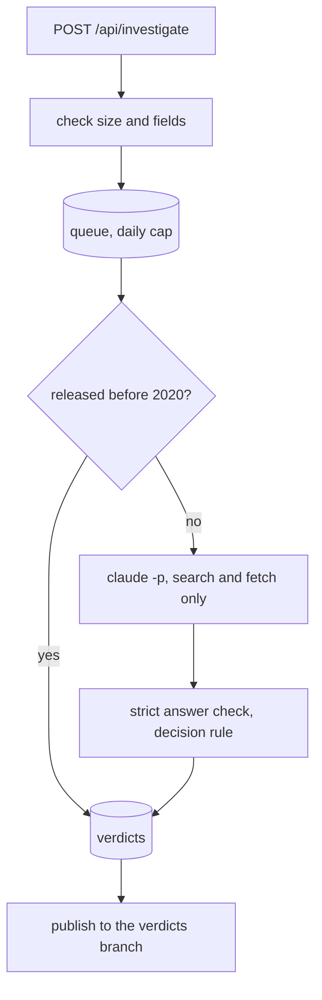

# Human Music investigator

A small service that checks, one artist at a time, whether the music is made by people or is AI-generated. Human Music asks it about artists it has not seen before. It stores a verdict for each one and publishes the list of verdicts to a git branch, where the extension reads it.

The service never makes a song skip by itself. A song is skipped only when the extension reads a stored, published `ai` verdict at a confidence the listener's mode accepts. If the service is down, nothing about playback changes.

## What it does

Each artist goes through the same steps:

1. A cheap pass looks up the release history. An artist with clear releases before 2020 is marked `human` with no further work.
2. Otherwise the service runs `claude -p` with web search and page fetch only. Claude gets no shell, no file tools and no git.
3. The service checks Claude's answer against a strict schema and drops anything else, without repairing it.
4. A decision rule in code sets the verdict. `ai` needs two different signals, or one strong one (an AI label from Deezer, the artist's own disclosure, a tracker listing). Anything weaker is stored as `unsure`.
5. The verdict goes into a SQLite file. A debounced publisher writes the list to a git branch.



Verdict words are `ai`, `human` and `unsure`. Confidence is an integer from 0 to 100. Reasons, sources and SH Labs scores stay on the server and never go into the published list.

## How the owner's keys stay out of Claude's reach

Strangers write page text and artist names, so a prompt injection can happen. The design assumes Claude might be talked into reading what the service holds, so the service holds nothing that opens a door.

- The service holds only `HM_KEY_HASH`, the SHA-256 of the access key. It holds neither the owner's admin key nor the derived key a client sends. `tools/make-key.mjs` runs once, by the owner, prints the derived key one time and writes only the hash.
- Requests are compared by hashing the presented key and using `crypto.timingSafeEqual`.
- Claude runs with web search and page fetch only. No shell, no file read or write, no git.
- Titles, names and page text reach Claude as fenced, untrusted data.
- The child process gets a minimal environment. All git work happens in the service's own code, with a deploy key that can write to the verdicts branch and cannot update `main`.
- The systemd unit runs as its own user with a read-only file system apart from its data folder.

## Routes

The service listens on `127.0.0.1:8140`. The nginx snippet exposes only the first four routes below, under `/human-music/`.

| Route | Needs key | What it does |
|---|---|---|
| `POST /api/investigate` | yes | Takes a batch of up to 20 items. Answers 202 with `{ queued, known, again }`. |
| `GET /api/status` | yes | Queue length, today's count, whether the queue is paused and why, the last error. |
| `POST /api/recheck` | yes | Body `{ key }`. Marks an artist for another look. Deletes nothing. |
| `GET /verdicts/<key>` | yes | Reasons, sources and SH Labs scores for one artist. |
| `OPTIONS` | no | CORS preflight, answered only for the allowed origin. |

A request without the right key gets 401 with one fixed body. A body over 64 KB gets 413. Each text field is cut to 300 characters and `artUrl` must be `https://`. Each artist can be sent once a day. One investigation runs at a time, up to the daily cap.

## Environment variables

Set in `/etc/human-music/env`. `deploy/env.example` is the template with empty values.

| Variable | Meaning |
|---|---|
| `HM_KEY_HASH` | SHA-256 of the access key. Written by `tools/make-key.mjs`. The service will not start without it. |
| `CLAUDE_CODE_OAUTH_TOKEN` | Claude login for the service, from `claude setup-token`. |
| `SHLABS_API_KEY` | Key for the SH Labs second opinion. |
| `HM_DAILY_CAP` | Deep investigations per day. Default 100. |
| `HM_ALLOWED_ORIGIN` | The one browser origin allowed to call the service. |
| `HM_DATA_DIR` | Folder for the database and reports. |
| `HM_PUBLISH_REMOTE` | Git remote that receives the published list. |
| `HM_PUBLISH_KEY_PATH` | Path to the deploy key used for publishing. |

## Tests

Node 22 or newer, no dependencies. From this folder:

```
npm test
```

Each file in `tests/` prints `N/N pass` and the run stops at the first failing file. The tests use stand-in collaborators, so they need no network, no Claude login and no keys. `tests/deploy.test.mjs` also checks that the files in `deploy/` carry no home paths, user names or key-like values.

## Install

Files for the install are in `deploy/`. Each step below changes the droplet and waits for the owner's explicit approval (Task 18 of the plan).

1. Create the system user `human-music` with no login, and the data folder `/var/lib/human-music`.
2. Copy this folder to `/opt/human-music-investigator`, then run `npm test` there. Every file must pass. This also confirms `node:sqlite` works on that Node.
3. The owner runs `tools/make-key.mjs` herself. It reads the admin key from standard input, prints the derived key once and writes `HM_KEY_HASH`.
4. Create `/etc/human-music/env` from `deploy/env.example` (owner root, group `human-music`, mode 640). The owner runs `claude setup-token` and pastes the token herself.
5. Set up the GitHub write key for the verdicts branch, and confirm with a test push that `main` is refused.
6. Install `deploy/human-music-investigator.service`, start it, and check that the status and log show no key.
7. Add `deploy/nginx-human-music.conf` (the `limit_req_zone` line goes in the http block), run `nginx -t`, then reload.
8. Smoke test: `/api/status` without a key is 401, with the key is 200, and one item queues.
9. Run the first calibration and the live check on two known AI-generated artists, then decide whether to accept the calibration.
