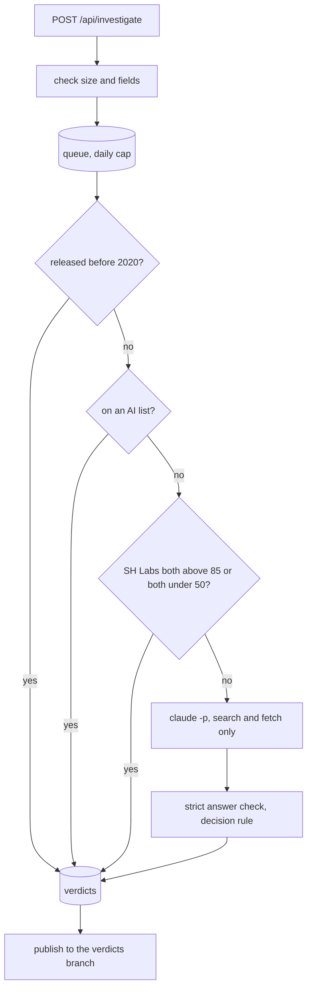

# Human Music investigator

A small service that checks, one artist at a time, whether the music is made by people or is AI-generated. Human Music asks it about artists it has not seen before. It stores a verdict for each one and publishes the list of verdicts to a git branch, where the extension reads it.

The service never makes a song skip by itself. A song is skipped only when the extension reads a stored, published `ai` verdict at a confidence the listener's mode accepts. If the service is down, nothing about playback changes.

## What it does

Each artist goes through a layered decision:

1. A cheap pass looks up the release history. An artist with clear releases before 2020 is marked `human` with no further work.
2. If the artist is on a maintained AI-artist list (Zoundhub, Soul Over AI, or Cevval by channel ID), it is marked `ai` at 100 confidence. Lists are downloaded at most once a day; if a list fails to download the last good copy is used.
3. The service then asks SH Labs to score the artist's top two Spotify tracks. If both scores are 85 or higher, it is `ai` at 94; if both are under 50, it is `human` at 95. For YouTube Music artists without a Spotify ID, the service links the artist to Deezer through MusicBrainz or by name, finds ISRCs, and scores those instead. Any other result or the day's request cap passes the artist on to Claude.
4. Only when the cheaper layers cannot answer does the service run `claude -p` with web search and page fetch only. Claude gets no shell, no file tools and no git.
5. The service checks Claude's answer against a strict schema and drops anything else, without repairing it.
6. A decision rule in code sets the verdict. `ai` needs two different signals, or one strong one (an AI label from Deezer, the artist's own disclosure, a tracker listing). Anything weaker is stored as `unsure`.
7. The verdict goes into a SQLite file. A publisher writes the list to a git branch once a day. The due time is stored, so a restart does not push it back, and a failed push is retried every 10 minutes.



Verdict words are `ai`, `human` and `unsure`. Confidence is an integer from 0 to 100. Reasons, sources and SH Labs scores stay on the server and never go into the published list.

## When something goes wrong

- Failures are judged only from Claude's own error text, never from page text it read, so a web page cannot pause the queue.
- A login problem, a usage limit, or a setup problem (for example `claude` missing from the service's PATH) pauses the queue and keeps the artist. A usage-limit pause lifts itself an hour after it began. The others wait for the owner to fix the cause and run `resume`.
- A timeout or crash sends the artist to the back of the queue to wait 15 minutes, at most twice. An answer that fails the schema check is dropped.
- IDs that Claude finds on the web are never stored. A record keeps only the IDs the extension sent from the page.
- Each publishing command stops after 2 minutes, the connection to GitHub after 20 seconds to connect or 30 seconds of silence, and SH Labs calls after 15 seconds. Publishing checks GitHub's published host keys, pinned in a `known_hosts` file the publisher writes, and refuses any other host.
- A verdict that did not meet the rule for `ai` stays under 95 after the confidence mapping.

## How the owner's keys stay out of Claude's reach

Strangers write page text and artist names, so a prompt injection can happen. The design assumes Claude might be talked into reading what the service holds, so the service holds nothing that opens a door.

- The service holds only `HM_KEY_HASH`, the SHA-256 of the access key. It holds neither the owner's admin key nor the derived key a client sends. `tools/make-key.mjs` runs once, by the owner, prints the derived key one time and writes only the hash.
- Requests are compared by hashing the presented key and using `crypto.timingSafeEqual`.
- Claude runs with web search and page fetch only. No shell, no file read or write, no git.
- Titles, names and page text reach Claude as fenced, untrusted data.
- The child process gets a minimal environment. All git work happens in the service's own code, with a deploy key that can write to the verdicts branch and cannot update `main`.
- The systemd unit runs as its own user with a read-only file system apart from its data folder.
- The unit sets `IPAddressDeny=localhost link-local multicast 10.0.0.0/8 172.16.0.0/12 192.168.0.0/16 100.64.0.0/10 fc00::/7`. WebFetch runs on the machine itself and connected to `127.0.0.1` in a live check, so neither the service nor its Claude children may reach this machine or private networks. Public addresses stay open for web research, GitHub and SH Labs. Only `127.0.0.53`, Ubuntu's local DNS stub, is allowed back, so name lookups still work.

## Routes

The service listens on a unix socket, `/run/human-music/investigator.sock` by default (`HM_SOCKET`), with no TCP port open. nginx proxies to that socket (the nginx user needs the `human-music` group to reach it). The snippet exposes only the first four routes below, under `/human-music/`.

| Route | Needs key | What it does |
|---|---|---|
| `POST /api/investigate` | yes | Takes a batch of up to 20 items. Answers 202 with `{ queued, known, again }`. |
| `GET /api/status` | yes | Queue length, today's count, whether the queue is paused and why, the last error. |
| `POST /api/recheck` | yes | Body `{ key }`. Marks an artist for another look. Deletes nothing. |
| `GET /verdicts/<key>` | yes | Reasons, sources and SH Labs scores for one artist. |
| `OPTIONS` | no | CORS preflight, answered only for the allowed origin. |

A request without the right key gets 401 with one fixed body. A body over 64 KB gets 413. Each text field is cut to 300 characters and `artUrl` must be `https://`. Each artist can be sent once a day. One investigation runs at a time, up to the daily cap.

## Environment variables

Set in `/etc/human-music/env`. `deploy/env.example` is the template with empty values.

| Variable | Meaning |
|---|---|
| `HM_KEY_HASH` | SHA-256 of the access key. Written by `tools/make-key.mjs`. The service will not start without it. |
| `CLAUDE_CODE_OAUTH_TOKEN` | Claude login for the service, from `claude setup-token`. |
| `SHLABS_API_KEY` | Key for the SH Labs second opinion. |
| `HM_SHLABS_DAILY_CAP` | SH Labs requests per day (two-track check per artist). Default 190. |
| `HM_DAILY_CAP` | Deep investigations per day. Default 100. |
| `HM_ALLOWED_ORIGIN` | The one browser origin allowed to call the service. |
| `HM_DATA_DIR` | Folder for the database and reports. |
| `HM_PUBLISH_REMOTE` | Git remote that receives the published list. |
| `HM_PUBLISH_KEY_PATH` | Path to the deploy key used for publishing. |
| `HM_SOCKET` | Unix socket to listen on. Default `/run/human-music/investigator.sock`. |
| `HM_SCORING` | Empty (the default): Claude fills in the evidence checklist and `src/score.mjs` decides. `off` goes back to Claude's own number. |

## Tests

Node 22 or newer, no dependencies. From this folder:

```
npm test
```

Each file in `tests/` prints `N/N pass` and the run stops at the first failing file. The tests use stand-in collaborators, so they need no network, no Claude login and no keys. `tests/deploy.test.mjs` also checks that the files in `deploy/` carry no home paths, user names or key-like values.

## Owner commands

Run as the service's user with the same environment file loaded: `node src/cli.mjs status`, `resume`, `recheck <key>`, `calibrate-run`, `calibrate` and `accept-calibration`. `resume` lifts a pause. `calibrate-run` investigates the labelled calibration sample (`--model opus|sonnet`, `--seed N`). `calibrate` fits the confidence mapping from the stored samples and prints the report; it does not run Claude. `accept-calibration` is the only command that turns the mapping on and marks the published list `calibrated: true`.

## Install

Files for the install are in `deploy/`. Each step below changes the droplet and waits for the owner's explicit approval (Task 18 of the plan).

1. Create the system user `human-music` with no login, and the data folder `/var/lib/human-music`.
2. Install the service's own `claude` with `npm install -g --prefix /opt/claude @anthropic-ai/claude-code` (the unit's PATH uses only `/opt/claude/bin`, `/usr/bin` and `/bin`). Copy this folder to `/opt/human-music-investigator`, then run `npm test` there. Every file must pass. This also confirms `node:sqlite` works on that Node.
3. Create `/etc/human-music/env` from `deploy/env.example` (owner root, group `human-music`, mode 640).
4. The owner runs `tools/make-key.mjs /etc/human-music/env --force` herself (`--force` because env.example has an empty `HM_KEY_HASH=` line). It reads the admin key from standard input, prints the derived key once and writes only `HM_KEY_HASH`. She then runs `claude setup-token` and pastes the token into the env file herself.
5. Set up the GitHub write key for the verdicts branch, and confirm with a test push that `main` is refused.
6. Install `deploy/human-music-investigator.service`, start it, and check that the status and log show no key and that `/run/human-music/investigator.sock` exists (mode 0660, group `human-music`). Add the nginx user to the `human-music` group.
7. Add `deploy/nginx-human-music.conf` (the `limit_req_zone` line goes in the http block), run `nginx -t`, then reload. It proxies to the socket from step 6.
8. Smoke test: `/api/status` without a key is 401, with the key is 200, and one item queues.
9. Run the first calibration and the live check on two known AI-generated artists, then decide whether to accept the calibration.
